# IntelXtract

## AI-Powered OSINT Automation & Intelligence Platform

---

**Final Project Report**  
**Major Project Submission**  
**Academic Year: 2025–2026**

---

| Field | Details |
|-------|---------|
| **Project Title** | IntelXtract: AI-Powered OSINT Automation & Intelligence Platform |
| **Subtitle** | Desktop Application for Open-Source Intelligence Collection, Correlation, and Reporting |
| **Domain** | Cybersecurity · OSINT · Threat Intelligence · Automation |
| **Primary Language** | Python 3.13+ |
| **GUI Framework** | PySide6 (Qt 6) |
| **Database** | SQLite (with forward-only migrations v1→v4) |
| **Architecture** | Modular Plugin-Based Architecture |
| **Target Platforms** | Windows, Linux, macOS |
| **Distribution** | PyInstaller Frozen Binaries, Docker Images, PyPI Wheel/Sdist |
| **License** | GPL-3.0-or-later |
| **Version** | 1.0.0 (Tag: `v1.0.0`) |
| **Repository** | `https://github.com/yourorg/IntelXtract` |

---

**Submitted by:**  
[Student Name]  
[Roll Number / Registration Number]  
[Department of Computer Science / Cybersecurity]  
[University / Institute Name]

**Under the Guidance of:**  
[Guide Name]  
[Designation]  
[Department]

**Date of Submission:** [Date]

---

*This report documents the complete software engineering lifecycle of IntelXtract, from requirements through implementation, testing, packaging, and release. All technical claims are substantiated by source code, test results, and documentation in the accompanying repository.*

---

# 2. Certificate

This is to certify that the project report titled **"IntelXtract: AI-Powered OSINT Automation & Intelligence Platform"** submitted by **[Student Name]** bearing roll number **[Roll Number]** in partial fulfillment of the requirements for the degree of **[Degree Name]** in **[Department Name]** is a bonafide record of work carried out under my supervision and guidance.

The project demonstrates comprehensive understanding of software engineering principles, cybersecurity fundamentals, and open-source intelligence methodologies. The implementation follows industry-standard practices including modular architecture, automated testing, continuous integration, and responsible disclosure policies.

**Signature:** _________________________  
**Guide Name:** [Guide Name]  
**Designation:** [Designation]  
**Department:** [Department Name]  
**Date:** [Date]

---

# 3. Acknowledgement

I would like to express my sincere gratitude to my project guide, **[Guide Name]**, for their invaluable guidance, encouragement, and constructive feedback throughout the development of IntelXtract. Their expertise in cybersecurity and software architecture shaped the technical direction of this project.

I am grateful to the faculty of **[Department Name]** for providing the academic foundation in secure software development, network security, and database systems that underpins this work.

Special thanks to the open-source community whose libraries and frameworks made this project possible: the Python Software Foundation, the Qt Project (PySide6), the NetworkX maintainers, the aiohttp team, and countless others.

I acknowledge the use of the following key technologies:
- **Python 3.13+** — core language
- **PySide6 6.10.3** — GUI framework
- **aiohttp 3.14.4** — asynchronous HTTP client
- **aiosqlite 0.22.1** — async SQLite driver
- **NetworkX 3.7** — graph algorithms for correlation
- **Typer 0.27.2** — CLI framework
- **Rich 15.0.0** — terminal formatting
- **Jinja2 3.1.6** — template engine for reports
- **WeasyPrint** — HTML-to-PDF conversion
- **Pillow 12.3.0** — image metadata extraction
- **pypdf 6.20.0** — PDF metadata extraction
- **cryptography 50.0.2** — API key encryption

Finally, I thank my peers and family for their patience and support during the long development cycles.

**Signature:** _________________________  
**[Student Name]**  
[Roll Number]  
[Date]

---

# 4. Abstract

IntelXtract is a desktop application for Open-Source Intelligence (OSINT) automation that consolidates reconnaissance workflows across domains, IP addresses, email addresses, usernames, websites, certificates, and file metadata into a single platform. The system addresses the fragmentation inherent in manual OSINT research — where analysts juggle dozens of browser tabs, command-line tools, and API consoles — by providing a unified engine that orchestrates 19 specialised collectors, correlates findings into an entity-relationship graph, scores risk using a deterministic rule engine, and produces professional reports in five formats.

The architecture follows a modular plugin-based design with strict separation between the scan engine (pure Python, async-first), the persistence layer (SQLite with forward-only migrations), the user interfaces (Typer CLI and PySide6 GUI), and the reporting subsystem (Jinja2 templates with WeasyPrint PDF backend). The engine implements a priority task scheduler, a bounded-concurrency worker pool with per-task timeouts, a shared async TTL cache, and a thread offload pool for blocking operations. Modules communicate through a typed `ModuleContext` that provides HTTP client access, API key resolution, configuration lookup, and memoization primitives.

Key achievements include:
- **19 OSINT modules** across 6 supported target types (Domain, IP, URL, Email, Username, File); file-hash (HASH) is classified but has no collector yet
- **Correlation engine** building NetworkX MultiDiGraphs with 8 edge types and confidence scoring
- **Risk engine** with 22 deterministic rules across 4 categories (TLS, Headers, DNS, Exposure) with category ceilings preventing single-category dominance
- **Encrypted API key vault** using Fernet symmetric encryption with OS keyring fallback
- **Scheduled scans** supporting interval and 5-field cron with overlap prevention and change detection
- **Case management** for grouping scans into investigations with combined reporting
- **Plugin SDK** with fail-soft discovery, manifest validation, and engine-parity adapters
- **Comprehensive test suite**: 756 tests, 89.54% branch coverage, fully offline integration tests
- **Cross-platform packaging**: PyInstaller binaries, Docker images, PyPI wheel/sdist
- **CI/CD pipeline**: GitHub Actions with quality gate (ruff, black, mypy, pytest) and release workflow

The project was developed in 29 phases following a documented phase-gate process, each verified by the quality gate (`ruff check . && black --check . && mypy . && pytest`). The final deliverable passes all quality checks, achieves 89.54% branch coverage (exceeding the 80% floor), and produces deterministic, reproducible outputs suitable for professional intelligence workflows.

**Keywords:** OSINT, reconnaissance, intelligence automation, correlation, risk scoring, plugin architecture, SQLite, asyncio, PySide6, NetworkX

---

# 5. Table of Contents

| # | Chapter | # | Chapter |
|---|---------|---|---------|
| 1 | Cover Page | 38 | Module Architecture |
| 2 | Certificate | 39 | Domain Reconnaissance Modules |
| 3 | Acknowledgement | 40 | IP Intelligence Modules |
| 4 | Abstract | 41 | URL and Website Modules |
| 5 | Table of Contents | 42 | Email Intelligence Modules |
| 6 | List of Figures | 43 | Username Reconnaissance Module |
| 7 | List of Tables | 44 | Certificate Transparency Module |
| 8 | Abbreviations | 45 | File Metadata Modules |
| 9 | Introduction | 46 | News and Timeline Module |
| 10 | Background and Motivation | 47 | Correlation Engine |
| 11 | Problem Statement | 48 | Entity Model |
| 12 | Objectives | 49 | Risk Engine |
| 13 | Scope | 50 | Risk Rules Catalog |
| 14 | Literature Survey and Existing Systems | 51 | Risk Rating and Verdicts |
| 15 | Proposed System | 52 | Reporting Subsystem |
| 16 | Feasibility Study | 53 | Report Templates and Exporters |
| 17 | Functional Requirements | 54 | Command-Line Interface |
| 18 | Non-Functional Requirements | 55 | GUI Architecture |
| 19 | Development Methodology | 56 | GUI Pages |
| 20 | Use Case Analysis | 57 | GUI Visualizations |
| 21 | System Workflows | 58 | AI Assistant |
| 22 | System Architecture Overview | 59 | Plugin SDK |
| 23 | Component Architecture | 60 | API Key Vault and Secrets Management |
| 24 | Data Flow Diagrams | 61 | Case Management |
| 25 | Project Directory Structure | 62 | Scheduler and Change Detection |
| 26 | Technology Stack | 63 | Threat Model |
| 27 | Core Engine Architecture | 64 | Privacy and Ethical Considerations |
| 28 | Input Engine and Target Classification | 65 | Testing Strategy |
| 29 | Task Scheduling and Prioritization | 66 | Test Suites and Coverage |
| 30 | Worker Pool and Concurrency | 67 | Performance and Benchmarks |
| 31 | Caching Subsystem | 68 | Packaging and Distribution |
| 32 | Offload Pool and Blocking Operations | 69 | CI/CD Pipeline |
| 33 | Configuration Management | 70 | Comparison with Existing Tools |
| 34 | Logging and Audit Subsystem | 71 | Advantages |
| 35 | Database Design | 72 | Limitations and Future Enhancements |
| 36 | Database Migrations | 73 | Conclusion |
| 37 | Repository and Persistence Layer | 74 | References and Appendices |

---

# 6. List of Figures

| Figure | Caption |
|--------|---------|
| Figure 15.1 | High-Level Feature Map of IntelXtract |
| Figure 19.1 | Phase-Gate Development Lifecycle |
| Figure 19.2 | Quality Gate Pipeline |
| Figure 20.1 | Use Case Diagram |
| Figure 21.1 | End-to-End Scan Workflow (Activity Diagram) |
| Figure 21.2 | Quick Scan versus Deep Scan (Sequence Diagram) |
| Figure 22.1 | Layered System Architecture |
| Figure 22.2 | Deployment Architecture |
| Figure 23.1 | Component Diagram |
| Figure 23.2 | Package Dependency Graph |
| Figure 24.1 | Level-0 Data Flow Diagram (Context) |
| Figure 24.2 | Level-1 Data Flow Diagram |
| Figure 25.1 | Repository Folder Structure |
| Figure 27.1 | Core Engine Class Diagram |
| Figure 27.2 | Scan Sequence Diagram |
| Figure 28.1 | Target Classification Flowchart |
| Figure 29.1 | Scheduling Architecture |
| Figure 30.1 | Worker Pool Concurrency Model |
| Figure 35.1 | Entity-Relationship Diagram |
| Figure 47.1 | Correlation Graph Structure |
| Figure 47.2 | Correlation Edge Types |
| Figure 53.1 | Export Pipeline |
| Figure 55.1 | GUI Architecture (Bridge and Thread Model) |
| Figure 56.1 | GUI Navigation Flow |
| Figure 56.2 | Dashboard Page (screenshot) |
| Figure 56.3 | Quick Scan Page (screenshot) |
| Figure 56.4 | Results Page (screenshot) |
| Figure 56.5 | Correlation Graph Visualisation (screenshot) |
| Figure 56.6 | Cases Page (screenshot) |
| Figure 56.7 | Reports Page (screenshot) |
| Figure 56.8 | API Manager Page (screenshot) |
| Figure 56.9 | Scheduler Page (screenshot) |
| Figure 57.1 | Visualization Data Flow |
| Figure 59.1 | Plugin Lifecycle |
| Figure 60.1 | Vault Key Resolution and Key Precedence |
| Figure 61.1 | Case Entity Relationships |
| Figure 62.1 | Scheduler Loop |
| Figure 63.1 | Trust Boundaries |
| Figure 65.1 | Test Pyramid and Gate |
| Figure 67.1 | Request Admission Control |
| Figure 68.1 | Packaging Pipeline |
| Figure 69.1 | CI/CD Flow |
| Figure 70.1 | Positioning |

---

# 7. List of Tables

| Table | Caption |
|-------|---------|
| Table 16.1 | Feasibility Analysis Summary |
| Table 17.1 | Functional Requirements |
| Table 18.1 | Non-Functional Requirements |
| Table 19.1 | Development Phase Summary |
| Table 20.1 | Actors and Responsibilities |
| Table 23.1 | Component Responsibilities |
| Table 26.1 | Technology Stack |
| Table 26.2 | Runtime Dependency Versions |
| Table 27.1 | Core Engine Components |
| Table 28.1 | Target Types and Classifiers |
| Table 28.2 | Engine Scan Profiles |
| Table 29.1 | Task Priority Levels |
| Table 31.1 | Cache Configuration Defaults |
| Table 33.1 | Configuration Precedence |
| Table 35.1 | Database Tables |
| Table 36.1 | Migration History |
| Table 38.1 | OSINT Module Inventory |
| Table 39.1 | Domain Module Findings |
| Table 40.1 | IP Module Findings |
| Table 41.1 | URL and Website Module Findings |
| Table 42.1 | Email Module Findings |
| Table 47.1 | Correlation Edge Types |
| Table 48.1 | Entity Kinds |
| Table 50.1 | Risk Rule Catalog |
| Table 50.2 | Risk Category Ceilings |
| Table 51.1 | Risk Rating Bands |
| Table 53.1 | Report Formats |
| Table 54.1 | CLI Command Reference |
| Table 56.1 | GUI Pages |
| Table 57.1 | Visualisation Widgets |
| Table 58.1 | Assistant Modes |
| Table 59.1 | Plugin Package Layout |
| Table 63.1 | Threat Summary |
| Table 64.1 | Data Egress |
| Table 64.2 | Data Stored Locally |
| Table 66.1 | Test Suite Summary |
| Table 66.2 | Measured Results |
| Table 67.1 | Benchmark Baseline |
| Table 67.2 | Concurrency Configuration |
| Table 68.1 | Distribution Artefacts |
| Table 69.1 | CI Workflow |
| Table 69.2 | Release Workflow |
| Table 70.1 | Feature Comparison |
| Table 72.1 | Known Limitations and Planned Enhancements |

---

# 8. Abbreviations

| Abbreviation | Expansion |
|--------------|-----------|
| AI | Artificial Intelligence |
| API | Application Programming Interface |
| ASGI | Asynchronous Server Gateway Interface |
| CA | Certificate Authority |
| CI/CD | Continuous Integration / Continuous Deployment |
| CLI | Command-Line Interface |
| CSV | Comma-Separated Values |
| CT | Certificate Transparency |
| CVE | Common Vulnerabilities and Exposures |
| DB | Database |
| DFD | Data Flow Diagram |
| DKIM | DomainKeys Identified Mail |
| DMARC | Domain-based Message Authentication, Reporting, and Conformance |
| DNS | Domain Name System |
| DNSBL | DNS Blocklist |
| DoH | DNS over HTTPS |
| E2E | End-to-End |
| ER | Entity-Relationship |
| EXIF | Exchangeable Image File Format |
| FQDN | Fully Qualified Domain Name |
| GUI | Graphical User Interface |
| HIBP | Have I Been Pwned |
| HTML | HyperText Markup Language |
| HTTP | HyperText Transfer Protocol |
| HTTPS | HyperText Transfer Protocol Secure |
| I/O | Input/Output |
| IP | Internet Protocol |
| JSON | JavaScript Object Notation |
| Lang | Language |
| MD | Markdown |
| MX | Mail Exchange |
| NFR | Non-Functional Requirement |
| OS | Operating System |
| OSINT | Open-Source Intelligence |
| OOXML | Office Open XML |
| PDF | Portable Document Format |
| PII | Personally Identifiable Information |
| PTR | Pointer Record (reverse DNS) |
| PyPI | Python Package Index |
| RDAP | Registration Data Access Protocol |
| RSS | Really Simple Syndication |
| SDK | Software Development Kit |
| SPF | Sender Policy Framework |
| SQL | Structured Query Language |
| SQLite | A self-contained, serverless SQL database engine |
| SSL | Secure Sockets Layer |
| TTL | Time To Live |
| TLS | Transport Layer Security |
| TOC | Table of Contents |
| URL | Uniform Resource Locator |
| UUID | Universally Unique Identifier |
| WHOIS | Who Is (domain registration directory service) |
| XSS | Cross-Site Scripting |

---

# 9. Introduction

Open-Source Intelligence (OSINT) is the discipline of collecting and analysing information from publicly available sources to produce actionable intelligence. In modern cybersecurity practice, OSINT underpins attack-surface discovery, due diligence, brand-protection monitoring, incident triage, and threat-actor profiling. The raw material is abundant — DNS records, WHOIS/RDAP registration data, TLS certificates, HTTP response headers, breach corpora, and public news feeds — but it is scattered across dozens of incompatible services, each with its own interface, rate limits, and output schema.

IntelXtract is a desktop application that unifies this fragmented workflow. It accepts a single indicator — a domain, IP address, URL, email address, username, file hash, or local file — classifies its type, selects an appropriate collection plan, executes a set of specialised async collectors, correlates the results into an entity graph, scores the target's risk with a deterministic rule engine, and renders the outcome as a professional report. The same engine is exposed through two front-ends: a scriptable command-line interface (CLI) and a graphical user interface (GUI) built on PySide6.

The name *IntelXtract* encodes the project's purpose: **Intel**ligence e**Xtract**ion. The application is deliberately local-first. It stores all data in a local SQLite database, performs no telemetry, requires no user account, and treats network egress as an explicit, auditable, opt-in event. When an AI assistant is enabled, it is clearly labelled as AI-generated and is disabled by default.

This report documents the complete engineering lifecycle of the system: the problem it solves, the architecture that realises it, the modules that implement each capability, the security and privacy posture, the testing evidence, and the packaging and release machinery. Every claim in this report is grounded in the repository's source code, tests, and documentation.

---

# 10. Background and Motivation

## 10.1 The OSINT Landscape

OSINT practitioners routinely combine tools such as `dig`, `whois`, `openssl s_client`, `curl`, `theHarvester`, certificate-transparency front-ends, and vendor APIs. Each tool answers one narrow question: *What are the A records? Who registered the domain? When does the certificate expire? What security headers are set?* The analytical value, however, lies in the **connections between these answers**. A certificate's subject-alternative-name field may reveal sibling domains; an MX record may point to a mail provider that implies a breach exposure; a favicon hash may link unrelated hosts to the same infrastructure.

Manual correlation is slow, error-prone, and difficult to reproduce. Analysts re-run the same commands, copy-paste into spreadsheets, and lose provenance. Existing automation platforms tend to be cloud-hosted (raising data-sovereignty concerns), closed-source, or expensive per-query.

## 10.2 Motivation

Three observations motivated IntelXtract:

1. **Fragmentation is the bottleneck, not collection.** Collectors are individually simple; orchestrating them, normalising their output, and preserving provenance is the hard part.
2. **Analysts need reproducible evidence.** A finding that cannot be traced to a timestamped source is not intelligence. Determinism and auditability are therefore first-class requirements.
3. **Privacy is non-negotiable.** Reconnaissance data is sensitive. A tool that silently uploads targets to a third party is unacceptable for many professional contexts.

These observations shaped the project's guiding principles: **unify collection behind a typed module contract**, **correlate and score deterministically**, **persist everything locally with full provenance**, and **make every network egress explicit**.

---

# 11. Problem Statement

The absence of a unified, local, reproducible OSINT workbench creates concrete problems:

- **Inefficiency.** An analyst targeting a single domain may invoke five to ten distinct tools, each requiring separate input, and then manually merge the outputs. This does not scale to investigations covering dozens of indicators.
- **Inconsistency.** Different tools emit different formats. The same fact (for example, a certificate issuer) may be represented in three ways, complicating comparison across targets and scans.
- **Loss of provenance.** Ad-hoc collection leaves no reliable record of *when* a datum was observed or *which* source produced it, undermining defensibility.
- **No correlation.** Isolated facts are rarely actionable. Without a graph linking domains, IPs, certificates, emails, and entities, relationships are invisible.
- **No prioritisation.** A flat list of findings offers no guidance on what matters. Analysts need a defensible, transparent risk score.
- **Privacy exposure.** Cloud tools exfiltrate target data by design.
- **Poor reproducibility.** Manual steps are hard to re-run identically, so change detection ("what changed since yesterday?") is impractical.

**Problem statement:** *There is a need for a privacy-preserving, local-first, extensible desktop platform that automates the collection of open-source intelligence across multiple indicator types, correlates the resulting findings into an explainable relationship graph, scores risk deterministically, and produces reproducible, professional reports — all while keeping the analyst in full control of data egress.*

---

# 12. Objectives

The project set the following measurable objectives:

1. **Multi-type collection.** Support the principal target types (Domain, IP, URL, Email, Username, File) with specialised collectors using only passive, publicly available sources.
2. **Unified orchestration.** Provide a single async engine that plans, schedules, executes, and aggregates module runs with deterministic ordering.
3. **Correlation.** Build an entity-relationship graph linking findings across modules with typed edges and confidence scoring.
4. **Explainable risk scoring.** Implement a deterministic rule engine with documented weights, category ceilings, and an auditable rule inventory.
5. **Dual interface.** Deliver a fully scriptable CLI and an equivalent graphical interface sharing one engine.
6. **Local persistence with provenance.** Store targets, scans, findings, reports, schedules, plug-ins, keys, logs, and cases in a versioned local database with forward-only migrations.
7. **Reproducible reporting.** Export byte-consistent reports in at least five formats (JSON, CSV, Markdown, HTML, PDF).
8. **Extensibility.** Provide a documented plug-in SDK so third parties can add collectors without modifying core code.
9. **Security and privacy.** Encrypt API keys at rest; disable all AI/telemetry by default; document the threat model.
10. **Quality.** Achieve ≥80% branch coverage with a passing quality gate (`ruff`, `black`, `mypy`, `pytest`) and fully offline integration tests.
11. **Packaged release.** Package via PyInstaller (Linux x86_64 release binaries), Docker, and PyPI, driven by CI/CD, for cross-platform Python (Linux, macOS, Windows).

Each objective maps to concrete evidence in later chapters.

---

# 13. Scope

## 13.1 In Scope

- **Passive reconnaissance** against publicly available data sources: DNS-over-HTTPS, RDAP/WHOIS, certificate transparency logs, HTTP(S) response inspection, breach-exposure APIs (key-gated), public news RSS, and local file metadata parsing.
- **Eight classified indicator types** (six with active collectors) and a pluggable module framework.
- **Local desktop usage** on Windows, Linux, and macOS, plus headless CLI and Docker execution.
- **Deterministic correlation and risk scoring.**
- **Report generation** and **scan scheduling** with change detection.
- **Case management** for grouping scans, notes, and evidence.
- **An optional, off-by-default AI assistant** that summarises and explains already-collected evidence.

## 13.2 Out of Scope

- **Active exploitation or intrusive scanning.** The tool performs no exploitation, no brute-forcing, and no vulnerability probing beyond reading public metadata. This is a deliberate ethical boundary.
- **Authenticated or credentialed access** to third-party systems.
- **Real-time streaming** or threat-feed subscription management.
- **Multi-user server deployment.** The architecture is single-user desktop-first; the Docker image provides headless execution, not a multi-tenant service.
- **Autonomous AI decision-making.** The assistant interprets evidence but never triggers scans or changes data on its own.

## 13.3 Assumptions

- The host has outbound network access to the configured public sources (or the user operates in an offline/cached mode).
- The analyst is authorised to investigate the targets and complies with applicable law and terms of service.
- Python 3.13 or newer is available for source installs; frozen binaries bundle their own runtime.

---

# 14. Literature Survey and Existing Systems

## 14.1 Academic and Standards Foundations

OSINT methodology draws on several established bodies of work: the intelligence cycle (planning, collection, processing, analysis, dissemination), MITRE's ATT&CK framework for adversarial technique taxonomy, and standards such as RDAP (RFC 7480–7484) and Certificate Transparency (RFC 6962). These inform IntelXtract's separation of collection from analysis and its emphasis on provenance.

## 14.2 Existing Tools

| Tool | Category | Strengths | Limitations relative to IntelXtract |
|------|----------|-----------|--------------------------------------|
| theHarvester | CLI recon | Broad source coverage, mature | No correlation graph, no risk scoring, no GUI, no persistence/reporting model |
| Maltego | Graph analysis | Excellent link analysis, transforms | Commercial, GUI-centric, transforms often cloud-hosted, not local-first |
| SpiderFoot | Automation platform | Many modules, correlator, web UI | Server-oriented, heavier deployment, weaker local desktop story |
| Recon-ng | CLI framework | Scriptable, modular | Steep learning curve, no first-class risk scoring or report templates |
| `dig`/`whois`/`openssl` | Point tools | Ubiquitous, precise | No aggregation, no persistence, no correlation, manual re-runs |
| Shodan/Censys APIs | Data services | Rich internet-wide data | Proprietary, per-query cost, data leaves the analyst's machine |
| Amass | Attack-surface mapping | Strong DNS/CT enumeration | Focused on enumeration, not scoring/reporting or GUI |

## 14.3 Gap Analysis

The survey reveals a consistent gap: **no single local-first desktop tool combines multi-type passive collection, explainable correlation, deterministic risk scoring, reproducible multi-format reporting, a dual CLI/GUI, and a documented plug-in SDK under a privacy-preserving default posture.** IntelXtract targets this gap directly. Chapter 70 returns to this comparison with a feature-by-feature matrix.

---

# 15. Proposed System

IntelXtract is organised around a small number of cooperating subsystems:

- **Input Engine** — classifies raw indicators into one of eight classified target types (Domain, IP, URL, Email, Username, Hash, File, Unknown) and selects a scan profile (quick or deep) that determines which modules run.
- **Scan Engine** — plans module runs as prioritised tasks, executes them through a bounded-concurrency worker pool with per-task timeouts, and aggregates findings and run metadata into a `ScanResult`.
- **Module Layer** — 19 collectors, each subclassing a common `BaseModule`, each declaring the target types it supports and the fields it produces.
- **Correlation Engine** — constructs a NetworkX `MultiDiGraph` from findings, adding typed edges (`resolves_to`, `registered_by`, `issued_to`, `same_email`, `part_of`, `mentions`, `profile`, `uses`) with confidence weights.
- **Risk Engine** — applies 22 deterministic rules across four categories, applies category ceilings, and derives a 0–100 score and rating.
- **Persistence Layer** — typed repositories over SQLite with forward-only migrations, storing targets, scans, findings, reports, schedules, cases, plug-ins, keys, settings, and logs.
- **Reporting Subsystem** — a shared `ReportModel` consumed by JSON, CSV, Markdown, HTML, and PDF exporters so all formats remain consistent.
- **Interfaces** — a Typer CLI and a PySide6 GUI that share the same engine and repository layer.
- **Assistant** — an optional, off-by-default facade over any OpenAI-compatible endpoint for grounded summarisation and explanation.
- **Plugin SDK** — a manifest-based loader with fail-soft discovery so third-party collectors integrate without core changes.

**Figure 15.1 – High-Level Feature Map of IntelXtract**

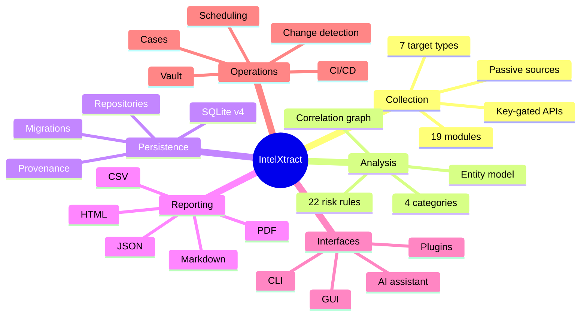

---

# 16. Feasibility Study

## 16.1 Technical Feasibility

The project is built entirely on mature, permissively licensed open-source components (Python, PySide6, aiohttp, aiosqlite, NetworkX, Jinja2, cryptography). No component requires custom infrastructure. The async-first engine relies on language features available since Python 3.5 and is validated on Python 3.13/3.14. Technical feasibility is therefore **high**.

## 16.2 Economic Feasibility

The stack is free. Development used a single workstation; CI runs on free GitHub Actions runners. Optional key-gated sources (for example, a breach-exposure API) have free tiers. There is no recurring infrastructure cost. Economic feasibility is **high**.

## 16.3 Operational Feasibility

The tool installs from a wheel, a frozen binary, or Docker, and requires no server, no account, and no database administration. The CLI is scriptable; the GUI is discoverable. Operational feasibility is **high**.

## 16.4 Legal and Ethical Feasibility

Only passive collection from public sources is performed. The project ships a `SECURITY.md`, an ethical-usage stance in the README, and a privacy document. No intrusive techniques are implemented. Users are responsible for authorisation and lawful use. Feasibility is **acceptable with documented user responsibility**.

## 16.5 Schedule Feasibility

The work was divided into 29 gated phases (Chapter 19), each producing a verifiable increment. All phases completed. Schedule feasibility was **demonstrated in practice**.

**Table 16.1 – Feasibility Analysis Summary**

| Dimension | Verdict | Key Evidence |
|-----------|---------|--------------|
| Technical | High | Mature OSS stack; validated on Python 3.13/3.14 |
| Economic | High | Zero licence/infra cost; free CI tiers |
| Operational | High | Wheel/binary/Docker install; no server, no account |
| Legal/Ethical | Acceptable | Passive-only; documented responsibility |
| Schedule | Demonstrated | 29 gated phases completed |

---

# 17. Functional Requirements

The functional requirements below use the identifier scheme `FR-n` and were traced from the phase plan and verified against tests.

**Table 17.1 – Functional Requirements**

| ID | Requirement | Priority | Verified By |
|----|-------------|----------|-------------|
| FR-1 | Classify a raw indicator into a target type | Must | `tests/core/test_input_engine.py` |
| FR-2 | Select quick/deep scan profile per target type | Must | engine tests |
| FR-3 | Execute modules concurrently with bounded workers | Must | worker-pool tests |
| FR-4 | Enforce per-task timeouts and record TIMEOUT status | Must | engine tests |
| FR-5 | Provide a shared async TTL cache with single-flight | Should | cache tests |
| FR-6 | Offload blocking work to a thread pool | Should | offload tests |
| FR-7 | Deduplicate findings by content hash | Must | engine tests |
| FR-8 | Build a correlation graph with typed, weighted edges | Must | correlation tests |
| FR-9 | Score risk deterministically with rules and ceilings | Must | risk tests |
| FR-10 | Persist targets, scans, findings, reports | Must | repository tests |
| FR-11 | Run forward-only migrations v1→v4 | Must | migration tests |
| FR-12 | Export JSON/CSV/Markdown/HTML/PDF reports | Must | exporter tests |
| FR-13 | Provide a full CLI command set | Must | CLI tests |
| FR-14 | Provide a GUI equivalent to the CLI | Should | pytest-qt tests |
| FR-15 | Encrypt API keys at rest | Must | vault tests |
| FR-16 | Support interval and cron schedules | Must | scheduling tests |
| FR-17 | Detect changes between successive scans | Must | diff tests |
| FR-18 | Group scans into cases with notes/evidence | Should | case tests |
| FR-19 | Load third-party plug-ins fail-soft | Should | plugin tests |
| FR-20 | Provide an optional, off-by-default AI assistant | Could | assistant tests |
| FR-21 | Store runtime settings in the DB | Should | settings tests |
| FR-22 | Log redacted audit events | Should | logger tests |
| FR-23 | Report application/dependency health | Should | doctor tests |
| FR-24 | Package as wheel, frozen binaries, Docker | Should | build scripts |

---

# 18. Non-Functional Requirements

**Table 18.1 – Non-Functional Requirements**

| ID | Requirement | Target | Evidence |
|----|-------------|--------|----------|
| NFR-1 | Test coverage (branch) | ≥ 80% | 89.54% measured (Ch. 66) |
| NFR-2 | Determinism | Byte-identical report given identical findings | golden report test |
| NFR-3 | Local-first privacy | No egress unless configured | assistant disabled default; privacy doc |
| NFR-4 | Secret protection | Keys encrypted at rest | Fernet vault (Ch. 60) |
| NFR-5 | Portability | Windows/Linux/macOS | packaging (Ch. 68) |
| NFR-6 | Performance | Engine ≥ thousands of scans/s in-memory | benchmarks (Ch. 67) |
| NFR-7 | Maintainability | Lint + format + types clean | quality gate (Ch. 19) |
| NFR-8 | Extensibility | Add collector without core edits | Plug-in SDK (Ch. 59) |
| NFR-9 | Offline testability | Integration tests need no internet | loopback mock (Ch. 65) |
| NFR-10 | Startup simplicity | Single-command CLI/GUI launch | entry points (Ch. 68) |
| NFR-11 | Robustness | Fail-soft modules; scan never aborts on one failure | per-module error capture |
| NFR-12 | Audability | Every finding has module, timestamp, evidence | provenance model |

---

# 19. Development Methodology

Development followed an iterative, **phase-gate** methodology. The project was decomposed into 29 phases (numbered 0 through 29), each with a defined deliverable and an explicit acceptance gate. A phase was considered complete only after the full quality gate passed.

**Figure 19.1 – Phase-Gate Development Lifecycle**

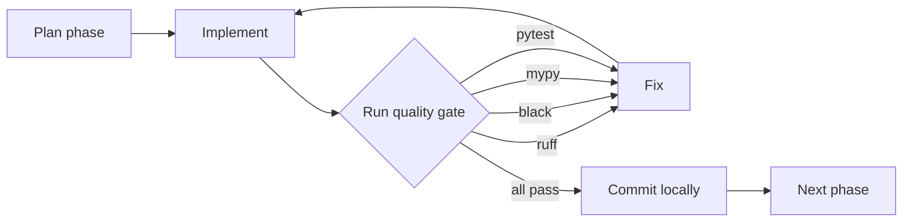

**Figure 19.2 – Quality Gate Pipeline**

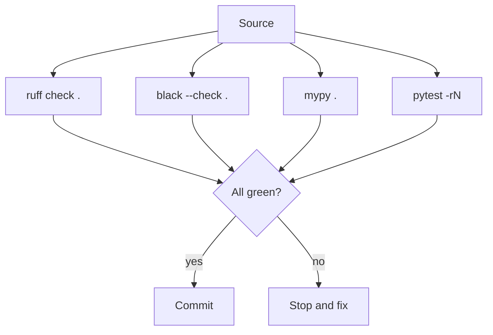

The gate command is:

```bash
export PATH="$PWD/.venv/bin:$PATH" && \
  black . && ruff check . && mypy . && \
  pytest -p no:cacheprovider -rN
```

**Table 19.1 – Development Phase Summary**

| Phase | Theme | Representative Deliverable |
|-------|-------|----------------------------|
| 0 | Scaffolding | Package layout, config, logging |
| 1–3 | Core foundations | Models, entities, HTTP client, cache |
| 4–6 | First modules | Domain/IP collectors, registry |
| 7–9 | Engine | Input engine, worker pool, scan engine |
| 10–12 | Persistence | SQLite schema, repositories, migrations |
| 13–15 | More modules | Email, username, website |
| 16 | Correlation | NetworkX graph engine |
| 17 | Risk | Rule-based scoring engine |
| 18 | Reporting | Shared model + exporters |
| 19–20 | CLI | Full command surface |
| 21 | GUI | PySide6 application |
| 22 | Cases | Investigation grouping |
| 23 | Assistant | Optional grounded AI |
| 24 | Vault | Encrypted API keys, settings |
| 25 | Performance | Pooling, caching, offload, benchmarks |
| 26 | Testing | Coverage gate, offline E2E |
| 27 | Documentation | Architecture + guides |
| 28 | Packaging | PyInstaller, Docker, PyPI |
| 29 | Release | v1.0.0, release workflow, tag |

> **Note on the phase plan document.** The summary table in `docs/Phase_Plan.md` still shows Phases 18 and 21 as unchecked although they are complete. This is a documentation inconsistency, not an implementation gap; it is recorded here for transparency.

---

# 20. Use Case Analysis

## 20.1 Actors

**Table 20.1 – Actors and Responsibilities**

| Actor | Description | Primary Use Cases |
|-------|-------------|-------------------|
| Analyst | Human investigator | Scan, review, report, schedule, manage cases |
| CLI User | Automation/scripted consumer | Batch scans, CI integration, report generation |
| GUI User | Desktop consumer | Interactive scan, visual exploration |
| Plugin Author | Third-party developer | Write and register collectors |
| Scheduler | Internal time-driven actor | Trigger recurring scans |
| AI Provider | Optional external service | Answer grounded prompts (opt-in) |
| Administrator | Operator | Configure keys, settings, health checks |

## 20.2 Use Case Diagram

**Figure 20.1 – Use Case Diagram**

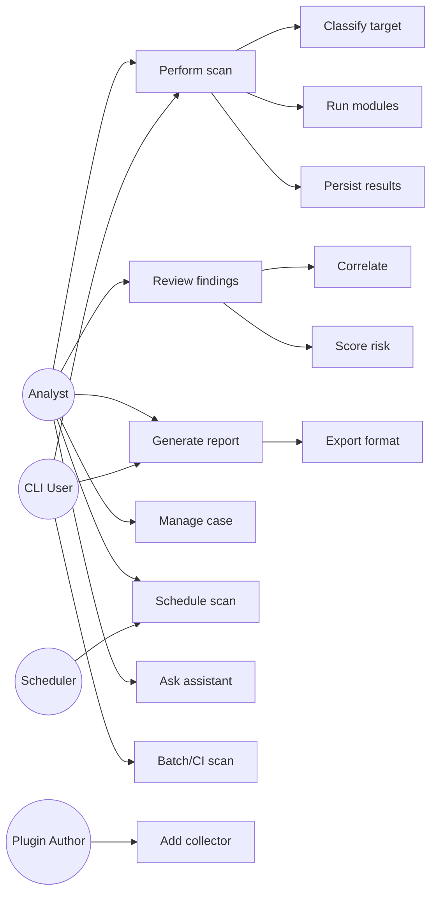

## 20.3 Representative Scenarios

1. **Ad-hoc domain check.** An analyst scans `example.com` in quick mode, reviews the risk rating and top findings, and exports an HTML report.
2. **Deep investigation.** The analyst runs a deep scan, explores the correlation graph, and attaches related findings to a case.
3. **Continuous monitoring.** The analyst schedules a daily scan; the scheduler detects that a new subdomain appeared and records a change event.
4. **Scripted batch.** A CI pipeline runs the CLI against an inventory list and fails if any target scores critical.
5. **Extension.** A plugin author adds a collector for a new data source and enables it from the CLI or GUI.

---

# 21. System Workflows

## 21.1 End-to-End Scan Workflow

**Figure 21.1 – End-to-End Scan Workflow (Activity Diagram)**

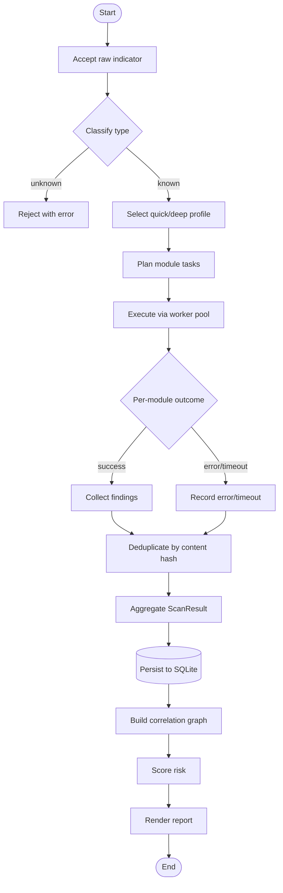

## 21.2 Quick versus Deep Scan

The input engine defines, per target type, a *quick* profile (fast, minimal network) and a *deep* profile (comprehensive, more sources). For a domain, quick runs `dns` and `http`; deep adds `whois`, `ssl`, `subdomain`, `website`, `certificate`, and `news`. For an IP, quick runs `geo` and `rdns`; deep adds `reputation`.

**Figure 21.2 – Quick Scan versus Deep Scan (Sequence Diagram)**

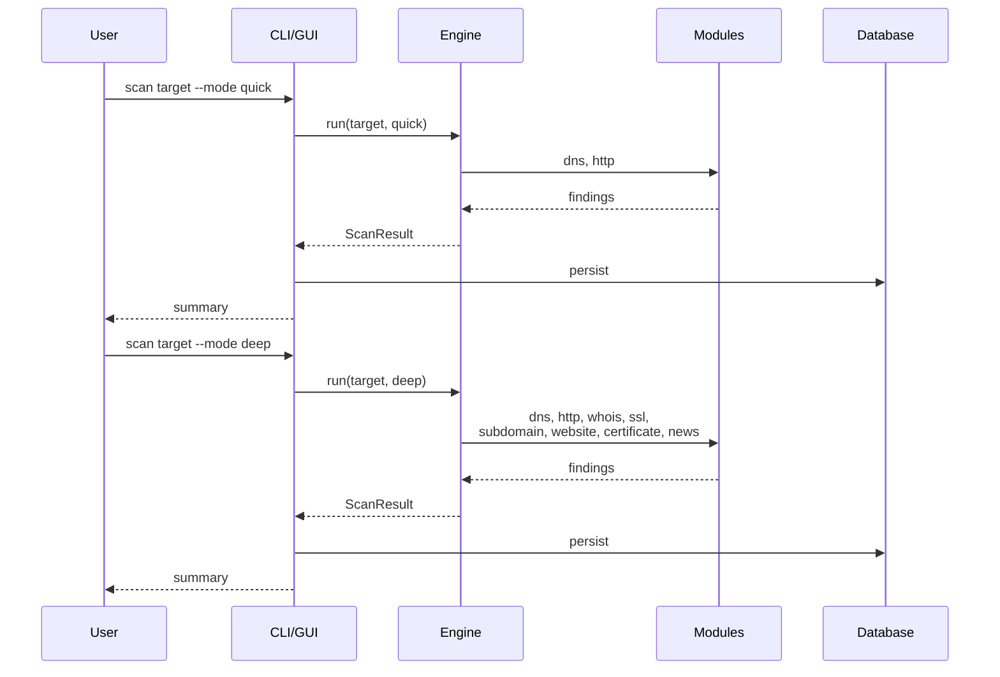

---

# 22. System Architecture Overview

IntelXtract follows a **layered, ports-and-adapters** architecture. A pure-Python asynchronous core contains all collection, correlation, and scoring logic and is completely independent of both the user interfaces and the database. The interfaces and the persistence layer attach to the core through explicit seams (`result_sink`, `classifier`, repository protocols), which keeps the core unit-testable and reusable.

## 22.1 Layered Architecture

**Figure 22.1 – Layered System Architecture**

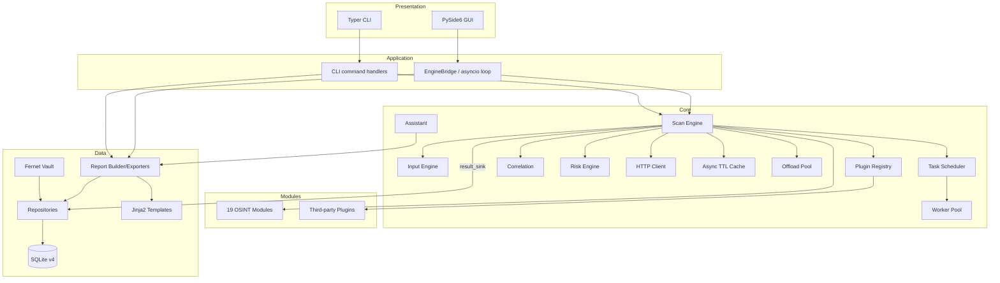

The dependency direction is strictly downward: the presentation layer may call the core, but the core never imports the GUI, the CLI, or the database. This is enforced by convention, reviewed per phase, and reflected in the coverage configuration, which measures `core`, `modules`, `reports`, and `plugins` only.

## 22.2 Deployment Architecture

**Figure 22.2 – Deployment Architecture**

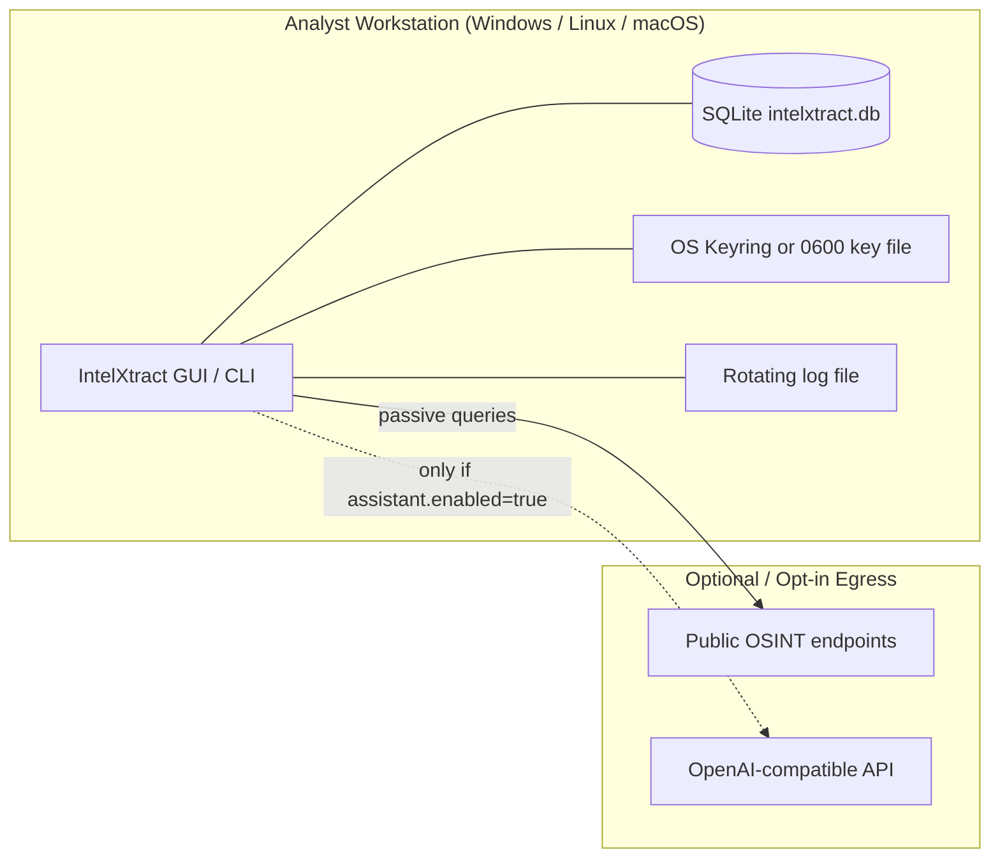

All persistent state lives on the analyst's machine. Network egress to OSINT sources occurs only when a scan runs, and egress to an AI provider occurs only when the assistant is explicitly enabled. There is no server component and no telemetry endpoint.

---

# 23. Component Architecture

**Figure 23.1 – Component Diagram**

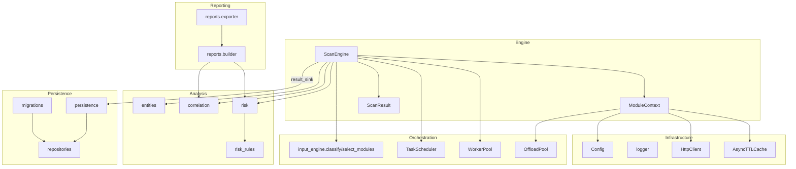

**Table 23.1 – Component Responsibilities**

| Component | Module | Responsibility |
|-----------|--------|----------------|
| Scan Engine | `core/engine.py` | Orchestrates plan → schedule → execute → aggregate |
| Module Context | `core/engine.py` | Per-scan services handed to modules (HTTP, cache, keys, offload) |
| Input Engine | `core/input_engine.py` | Classify, normalise, and profile targets |
| Task Scheduler | `core/scheduler.py` | Priority queue and per-task state accounting |
| Worker Pool | `core/worker_pool.py` | Bounded-concurrency execution with timeouts |
| Offload Pool | `core/offload.py` | Run blocking callables off the event loop |
| HTTP Client | `core/http_client.py` | Retries, backoff, throttling, conditional caching |
| Cache | `core/cache.py` | LRU + per-key TTL, single-event-loop |
| Config | `core/config.py` | Layered defaults → JSON → env |
| Logger | `core/logger.py` | Redacting console + rotating file, scan context |
| Entities | `core/entities.py` | Canonical entity extraction and identity |
| Correlation | `core/correlation.py` | NetworkX entity graph with typed edges |
| Risk Rules | `core/risk_rules.py` | 22 deterministic rule definitions |
| Risk Engine | `core/risk.py` | Category ceilings, score, rating, summary |
| Repositories | `database/repositories.py` | Typed CRUD over SQLite |
| Persistence | `database/persistence.py` | Engine `result_sink`, history, case payloads |
| Migrations | `database/migrations.py` | Forward-only v1→v4 schema evolution |
| Report Builder | `reports/builder.py` | Assemble the shared `ReportModel` |
| Report Exporter | `reports/exporter.py` | JSON/CSV/Markdown/HTML/PDF rendering |
| Plugin Loader | `core/plugin_loader.py` | Fail-soft discovery and engine adapters |

## 23.1 Package Dependency Graph

**Figure 23.2 – Package Dependency Graph**

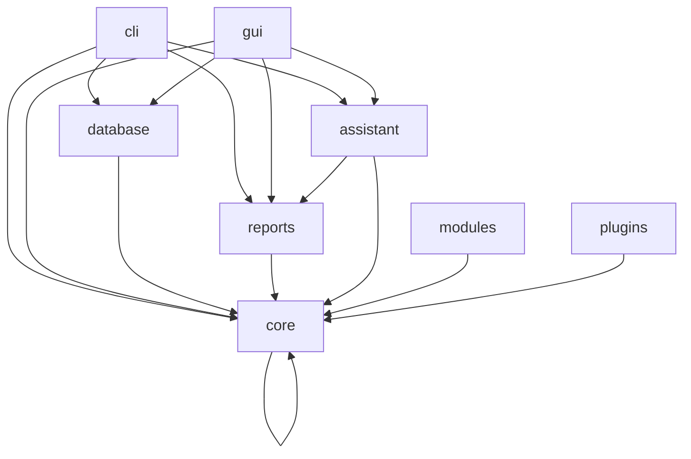

The graph confirms that `core` is the only widely-shared dependency and that no cycle returns from `core` to the outer layers.

---

# 24. Data Flow Diagrams

## 24.1 Level-0 (Context) Diagram

**Figure 24.1 – Level-0 Data Flow Diagram (Context)**

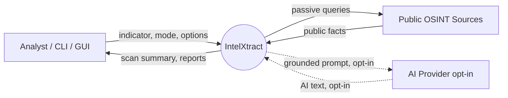

## 24.2 Level-1 Diagram

**Figure 24.2 – Level-1 Data Flow Diagram**

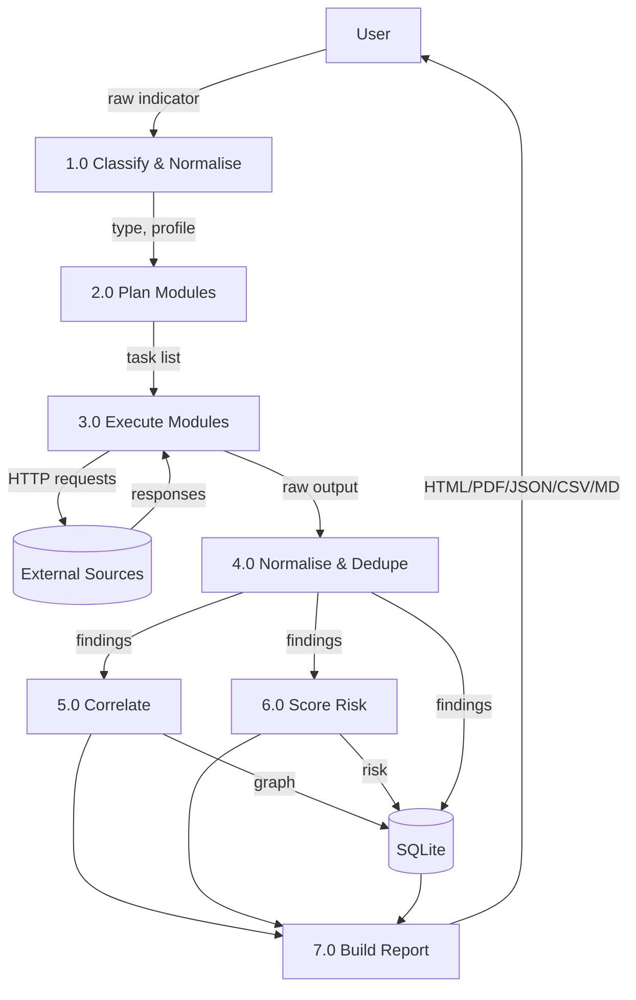

The level-1 diagram shows the seven core processes and two data stores (the SQLite database and the external sources). Provenance travels with each datum: findings retain their module, timestamp, and evidence through every stage.

---

# 25. Project Directory Structure

**Figure 25.1 – Repository Folder Structure**

```mermaid
flowchart TD
    Root[IntelXtract/] --> app[app/ - application config]
    Root --> assets[assets/ - icons, brand]
    Root --> assistant[assistant/ - optional AI facade]
    Root --> cli[cli/ - Typer CLI]
    Root --> config[config/ - settings.json]
    Root --> core[core/ - engine, analysis, infra]
    Root --> database[database/ - schema, repos, migrations]
    Root --> docs[docs/ - guides and design]
    Root --> examples[examples/ - sample reports]
    Root --> gui[gui/ - PySide6 UI]
    Root --> modules[modules/ - 19 collectors]
    Root --> plugins[plugins/ - third-party]
    Root --> reports[reports/ - builder + exporters]
    Root --> scripts[scripts/ - build, bench, pyinstaller]
    Root --> templates[templates/ - Jinja2]
    Root --> tests[tests/ - pytest suites]
```

The `modules/` package is organised by target family:

- `modules/domain/` — `dns`, `http`, `ssl`, `subdomain`, `whois`
- `modules/ip/` — `geo`, `rdns`, `reputation`
- `modules/website/` — `favicon`, `headers`, `http_methods`, `robots`, `tech`
- `modules/email/` — `email`, `breach`
- `modules/username/` — `username`
- `modules/certificate/` — `certificate`
- `modules/metadata/` — `metadata`
- `modules/news/` — `news`

---

# 26. Technology Stack

**Table 26.1 – Technology Stack**

| Layer | Technology | Rationale |
|-------|-----------|-----------|
| Language | Python 3.13+ | Rich async ecosystem, cross-platform |
| Async runtime | `asyncio` | Concurrency for I/O-bound collection |
| GUI | PySide6 (Qt 6) | Native look, mature widgets, graphics |
| CLI | Typer + Rich | Typed commands, styled terminal output |
| HTTP | aiohttp | Async client with connection pooling |
| Database | SQLite via aiosqlite | Serverless, local-first, async |
| Graph | NetworkX | MultiDiGraph algorithms for correlation |
| Templates | Jinja2 | HTML report rendering |
| PDF | WeasyPrint (optional) | HTML→PDF with graceful fallback |
| Crypto | `cryptography` (Fernet) | Authenticated symmetric encryption |
| Metadata | Pillow, pypdf | Image EXIF and PDF metadata |
| Testing | pytest, pytest-asyncio, pytest-cov, pytest-qt | Async, coverage, Qt UI tests |
| Quality | ruff, black, mypy | Lint, format, static typing |
| Packaging | PyInstaller, build, Docker | Binaries, wheel/sdist, containers |
| CI/CD | GitHub Actions | Quality gate and release automation |

**Table 26.2 – Runtime Dependency Versions**

| Package | Version | Purpose |
|---------|---------|---------|
| aiohttp | 3.14.4 | Async HTTP |
| aiosqlite | 0.22.1 | Async SQLite driver |
| typer | 0.27.2 | CLI framework |
| rich | 15.0.0 | Terminal formatting |
| jinja2 | 3.1.6 | Templating |
| PySide6 | 6.10.3 | GUI |
| cryptography | 50.0.2 | Encryption |
| networkx | 3.7 | Graph analysis |
| Pillow | 12.3.0 | Image parsing |
| pypdf | 6.20.0 | PDF parsing |

Optional: `weasyprint` (PDF; if absent, a print-friendly HTML fallback is produced with a warning), `keyring` (OS keyring vault backend).

---

# 27. Core Engine Architecture

The scan engine is the heart of IntelXtract. `ScanEngine.scan()` implements a fixed pipeline: validate → classify → plan → schedule → execute → aggregate → correlate → score → sink.

**Figure 27.1 – Core Engine Class Diagram**

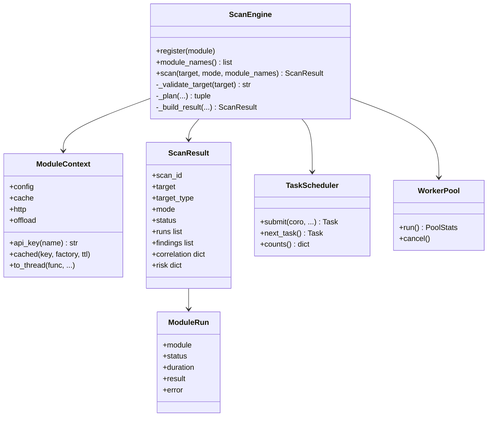

**Table 27.1 – Core Engine Components**

| Component | Role |
|-----------|------|
| `ScanEngine` | Public facade; owns config, cache, classifier, sink |
| `ModuleContext` | Service container passed to each `module.run` |
| `ScanResult` | Immutable-ish structured outcome with runs, findings, graph, risk |
| `ModuleRun` | Per-module status/duration/result/error |
| `Task` / `TaskScheduler` | Prioritised task queue with state accounting |
| `WorkerPool` | Consumes tasks with bounded concurrency and timeouts |

## 27.1 Scan Sequence

**Figure 27.2 – Scan Sequence Diagram**

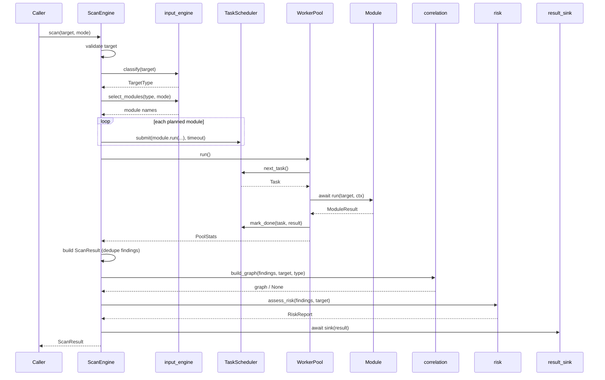

**Robustness guarantee:** module failures never abort a scan. Exceptions raised inside a module are captured per task and reported as `FAILED` or `TIMEOUT` runs; correlation and risk assessment are individually guarded so that an analysis error degrades gracefully to `None` rather than failing the scan.

---

# 28. Input Engine and Target Classification

The input engine converts a raw string into a canonical target and a collection plan. Classification uses an ordered precedence (first match wins), documented in the module docstring and reproduced here.

**Figure 28.1 – Target Classification Flowchart**

```mermaid
flowchart TD
    S([Raw input]) --> E{empty?}
    E -->|yes| U[UNKNOWN]
    E -->|no| URL{schema or host/path?}
    URL -->|yes| TURL[URL]
    URL -->|no| EMAIL{user@host valid?}
    EMAIL -->|yes| TEMAIL[EMAIL]
    EMAIL -->|no| IP{IPv4/IPv6?}
    IP -->|yes| TIP[IP]
    IP -->|no| HASH{32/40/64 hex?}
    HASH -->|yes| THASH[HASH]
    HASH -->|no| FILE{path or known ext?}
    FILE -->|yes| TFILE[FILE]
    FILE -->|no| DOMAIN{hostname with dot?}
    DOMAIN -->|yes| TDOMAIN[DOMAIN]
    DOMAIN -->|no| USER{handle pattern?}
    USER -->|yes| TUSER[USERNAME]
    USER -->|no| U
```

**Table 28.1 – Target Types and Classifiers**

| Type | Recognition rule | Normalisation |
|------|------------------|---------------|
| URL | `scheme://…` or host-with-path/path | Default scheme `https`, punycode host, lowercase scheme |
| EMAIL | `user@host` with valid host | Lowercase host, preserve local part |
| IP | IPv4/IPv6 (port via `[v6]:port`) | Compressed canonical form |
| HASH | 32/40/64 lowercase hex | Lowercase |
| FILE | Path separators, drive letter, `~`, dotfile, known extension | Verbatim |
| DOMAIN | Valid hostname with ≥1 dot | Punycode, lowercase, strip trailing dot |
| USERNAME | Bare handle `[A-Za-z0-9][A-Za-z0-9_.-]{1,31}` | Strip leading `@` |
| UNKNOWN | Nothing matched | Verbatim |

**Documented trade-offs:** `example.md` classifies as FILE (the file-extension rule precedes the domain rule); `john.doe` classifies as DOMAIN; `localhost:3000` classifies as USERNAME; IPv6 with a port requires bracket notation.

## 28.1 Scan Profiles

**Table 28.2 – Engine Scan Profiles**

| Target type | Quick modules | Deep modules |
|-------------|---------------|--------------|
| Domain | dns, http | whois, dns, ssl, subdomain, http, certificate, news (+ website) |
| IP | geo, rdns | geo, rdns, reputation |
| URL | headers, http_methods | headers, tech, favicon, robots, http_methods, certificate |
| Email | email | email, breach, domain |
| Username | username | username |
| File | metadata | metadata |
| Hash | — | — |

The deep profile is also used for `custom` scans; a caller may pass explicit module names, which are validated against the registry. Unknown module names raise a `ValidationError` before any execution begins.

---

# 29. Task Scheduling and Prioritization

`TaskScheduler` is a priority queue backed by `asyncio.PriorityQueue`. Lower priority numbers run first; equal priorities run in FIFO order via a monotonically increasing sequence counter. Worker sentinels are inserted at the lowest possible priority so they are dequeued only after all real work.

**Figure 29.1 – Scheduling Architecture**

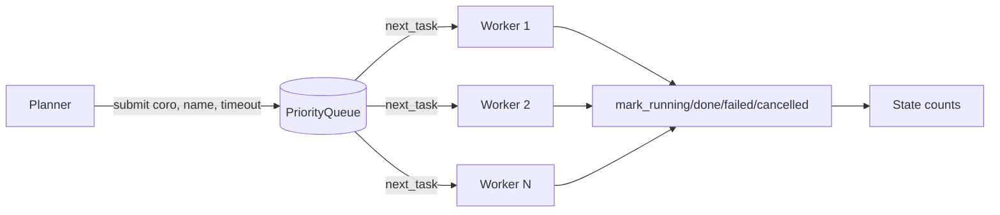

**Table 29.1 – Task Priority Levels**

| Priority | Use | Notes |
|----------|-----|-------|
| Negative / low | Fast, foundational probes | Run first to unblock dependents |
| 0 (default) | Standard module tasks | FIFO within the same priority |
| High positive | Deferred / enrichment work | Run last |
| Sentinel (`2^31-1`) | Worker shutdown marker | Never counted as a task |

Each `Task` records `created_at`, `started_at`, `finished_at`, and derives `duration`. Unstarted coroutines are explicitly closed (`Task.close()`) to prevent "coroutine was never awaited" warnings and resource leaks.

---

# 30. Worker Pool and Concurrency

The `WorkerPool` consumes tasks from the scheduler with a fixed number of asyncio workers (default 8, configurable via `scan.max_workers`). It applies a per-task timeout, isolates failures, and supports cancellation of both queued and in-flight work.

**Figure 30.1 – Worker Pool Concurrency Model**

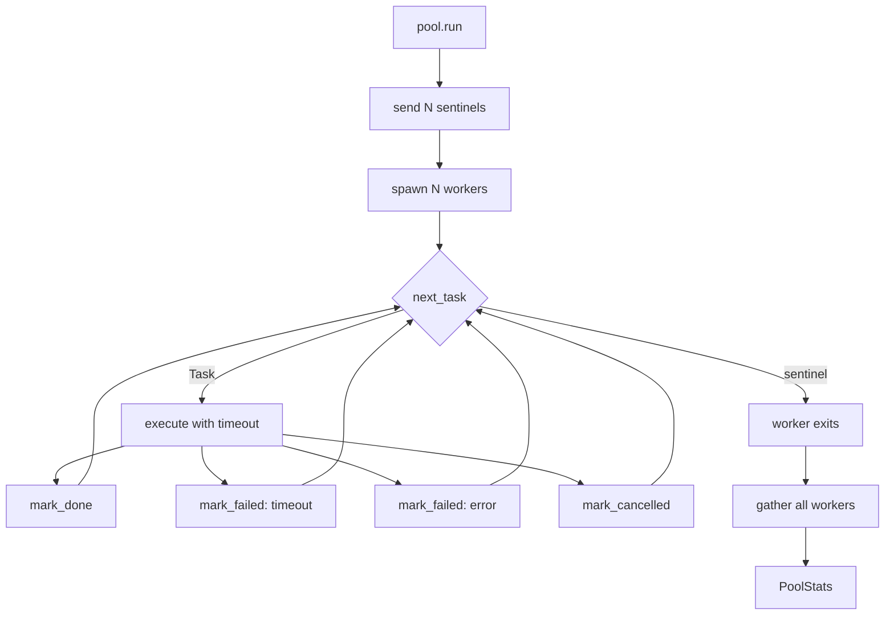

The pool exposes `peak_in_flight` for observability and a `PoolStats` summary (`submitted`, `done`, `failed`, `cancelled`, `duration`). The `on_task_done` callback — used by the CLI and GUI for live progress — is wrapped so that a misbehaving callback can never crash a worker.

---

# 31. Caching Subsystem

`AsyncTTLCache` is a single-event-loop LRU cache with per-key TTL. It supports an enable flag, a default TTL, a maximum size with LRU eviction, and hit/miss/eviction/expiration counters.

**Table 31.1 – Cache Configuration Defaults**

| Setting | Default | Meaning |
|---------|---------|---------|
| `cache.enabled` | `true` | Master switch |
| `cache.ttl` | `300.0` s | Default time-to-live |
| `cache.max_size` | `1024` | Maximum entries before LRU eviction |

Modules memoise expensive lookups through `ctx.cached(key, factory, ttl=…)`, which returns a cached value or runs the factory and stores the result. The HTTP client additionally uses the cache for conditional requests (`If-None-Match` / `If-Modified-Since`), returning a stored payload on `304 Not Modified`. The benchmark suite records cache throughput above 2.5 million operations per second in memory (Chapter 67).

---

# 32. Offload Pool and Blocking Operations

Blocking work — PDF/EXIF parsing, large JSON decode, filesystem reads — must not run on the event loop, or it stalls every concurrent task. `OffloadPool` wraps a bounded `ThreadPoolExecutor` (default 4 workers, `performance.offload_workers`) so callers can `await pool.run(func, …)` without spawning unbounded threads.

Modules use `ctx.to_thread(...)`, which prefers the per-scan pool and falls back to `asyncio.to_thread`. A process-wide convenience pool (`offload()`, `get_offload_pool()`) serves scripts and tests. The pool tracks `submitted`/`completed` counters and shuts down cleanly via `shutdown()` or `aclose()`.

---

# 33. Configuration Management

Configuration is layered with clear precedence and dotted-key access.

**Table 33.1 – Configuration Precedence**

| Priority | Source | Example |
|----------|--------|---------|
| 1 (lowest) | Built-in defaults (`DEFAULTS`) | `scan.max_workers = 8` |
| 2 | JSON file (`config/settings.json`) | `{"scan": {"max_workers": 16}}` |
| 3 (highest) | `.env` file and environment variables | `INTELXTRACT_SCAN__MAX_WORKERS=16` |

Environment variables use the `INTELXTRACT_` prefix; a double underscore maps to nesting (`SCAN__MAX_WORKERS` → `scan.max_workers`). Values are coerced to JSON types when possible. The `api_keys` section is **never** written back to the config file (`Config.save()` strips it); secrets belong to the encrypted vault (Chapter 60). `load_env_file()` reads `KEY=VALUE` pairs, honours quotes and comments, and never overwrites variables that are already set in the environment.

---

# 34. Logging and Audit Subsystem

Logging uses the standard library with a dedicated `intelxtract` namespace. Handlers are a console stream (optional) and a rotating file handler (`logging.max_bytes`, `logging.backup_count`).

Two features distinguish the logging layer:

1. **Secret redaction.** A custom formatter applies regular expressions that mask bearer tokens and `key=value`/`key: value` pairs for `api_key`, `token`, `secret`, `password`, and `authorization`, replacing the value with `***REDACTED***`.
2. **Scan context.** A `ContextVar` holds the current scan id; a logging filter injects it into every record as `[scan=<id>]`, so log lines from concurrent modules remain attributable. The `scan_context()` context manager binds and restores the id around each scan.

The database additionally stores structured audit events in the `logs` table (level, message, source, JSON context, timestamp), queryable via the `LogRepository`.

---

# 35. Database Design

IntelXtract persists all state in a single SQLite database accessed asynchronously through `aiosqlite`. The schema is normalised around **targets → scans → findings**, with satellite tables for reports, schedules, cases, plugins, keys, settings, logs, and history.

**Table 35.1 – Database Tables**

| Table | Purpose | Key columns |
|-------|---------|-------------|
| `schema_version` | Applied migrations | `version` (PK), `name`, `applied_at` |
| `targets` | Classified indicators | `id`, `value`, `type`; unique `(value, type)` |
| `scans` | Scan runs | `id`, `target_id` FK, `uuid` (unique), `mode`, `status`, `runs_json` |
| `findings` | Normalised intelligence | `id`, `scan_id` FK, `module`, `title`, `severity`, `confidence`, `data`, `evidence`, `content_hash` |
| `reports` | Generated report files | `id`, `scan_id` FK, `path`, `format` |
| `plugins` | Plugin metadata | `name` (unique), `version`, `api_version`, `enabled`, `source`, `error` |
| `api_keys` | Encrypted secrets | `provider` (unique), `ciphertext`, `hint` |
| `logs` | Audit events | `level`, `message`, `source`, `context` |
| `history` | Per-target change events | `target_id`, `scan_id`, `event_type`, `payload` |
| `settings` | Runtime settings | `key` (PK), `value` (JSON), `updated_at` |
| `schedules` | Recurring scans | `target`, `mode`, `interval_seconds`/`cron`, `enabled`, `status`, `next_run_at` |
| `cases` | Investigations | `name` (unique), `description`, `status` |
| `case_notes` | Case notes | `case_id` FK, `body` |
| `case_evidence` | Case evidence links | `case_id`, `scan_id`, `finding_id`, `kind`, `label` |

Referential integrity is enforced with `ON DELETE CASCADE` for scan-owned rows (findings, reports) and `ON DELETE SET NULL` where a soft link is preferable (for example, `history.scan_id`, `case_evidence.scan_id`). Check constraints guard `confidence ∈ [0,1]` and boolean-like `enabled` columns. Indices cover every foreign key and the common filters (`scans.status`, `findings.scan_id`, `schedules.next_run_at`, `cases.name`).

## 35.1 Entity-Relationship Diagram

**Figure 35.1 – Entity-Relationship Diagram**

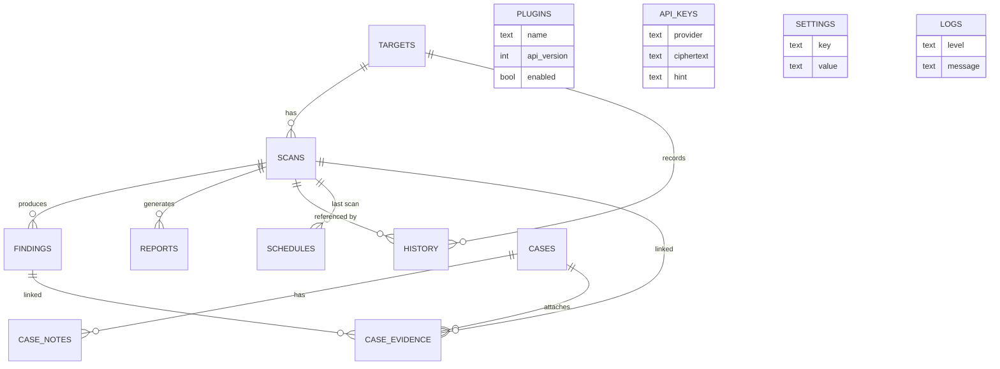

---

# 36. Database Migrations

The schema evolves through **forward-only, immutable migrations**. Each migration has a unique version and name and is recorded in `schema_version` once applied. Migration 1 loads `database/schema.sql`; later migrations add columns or tables via `ALTER TABLE` / `CREATE TABLE`.

**Table 36.1 – Migration History**

| Version | Name | Change |
|---------|------|--------|
| 1 | initial schema | targets, scans, findings, reports, plugins, api_keys, logs, history, settings |
| 2 | finding normalized fields | add `findings.title`, `evidence`, `content_hash`, `collected_at` |
| 3 | recurring schedules | add `schedules` table + indices |
| 4 | case management | add `cases`, `case_notes`, `case_evidence` |

The runner validates that versions are unique and contiguous starting at 1, applies only pending migrations in order, and records the failure point without marking a failed migration as applied. The initial SQL is loaded with `importlib.resources` so it resolves correctly inside a PyInstaller bundle.

---

# 37. Repository and Persistence Layer

All SQL lives in `database/repositories.py` (the only place besides migrations). Rows are returned as **frozen, slotted dataclasses**; JSON columns are parsed on read and serialised on write. This keeps SQL out of the engine and the UI and gives the rest of the application typed records.

The `Repositories` bundle exposes:

- `TargetRepository` — `get_or_create`, `get`, `list`
- `ScanRepository` — `create`, `create_for_result`, `list`, `list_detailed`, `latest_for_target`, `stats`
- `FindingRepository` — `bulk_create`, `list_for_scan`, `count_for_scan`, `get`
- `ReportRepository`, `PluginRepository`, `ApiKeyRepository`, `LogRepository`, `HistoryRepository`
- `ScheduleRepository` — implements the `ScheduleStore` protocol consumed by the runner
- `CaseRepository` — cases plus notes and evidence
- `SettingRepository` — JSON settings

`database/persistence.py` bridges the engine and the database **without the engine importing the database**: `make_result_sink(db)` returns an async callable that persists a completed `ScanResult` (target, scan, findings). It also implements change history (`record_scan_change`) by diffing consecutive scans, and assembles case payloads (`collect_case_payload`) for combined reporting, de-duplicating findings by id.

---

# 38. Module Architecture

Every collector subclasses `BaseModule` (in `modules/base.py`) and declares three pieces of metadata: `name`, `target_types`, and `requires_keys`. The engine's planner skips modules whose `requires_keys` are unconfigured, and modules whose `target_types` do not include the classified type.

```python
class BaseModule(ABC):
    name: str = ""
    target_types: tuple[TargetType, ...] = ()
    requires_keys: tuple[str, ...] = ()
    description: str = ""

    def validate(self, target: str) -> bool: ...

    @abstractmethod
    async def run(self, target: str, ctx: ModuleContext) -> ModuleResult: ...
```

Shared conveniences (`http_get_json`, `http_get_text`, `http_fetch`) keep collectors thin, and a `retry` decorator plus `run_with_timeout` provide resilience. Collectors return a `ModuleResult` whose `findings` are normalised by `parse_findings` and deduplicated by a stable SHA-256 `content_hash` over module, title, severity, data, and evidence.

**Table 38.1 – OSINT Module Inventory**

| # | Module | Target type | Requires key | Description |
|---|--------|-------------|--------------|-------------|
| 1 | `dns` | Domain | — | DoH records A/AAAA/CNAME/NS/MX/TXT, SPF, DMARC, DKIM |
| 2 | `http` | Domain | — | HTTP(S) status, redirects, robots/sitemap, security headers |
| 3 | `ssl` | Domain | — | TLS certificate metadata (subject, issuer, validity, SANs) |
| 4 | `whois` | Domain | — | RDAP registrar, dates, contacts, DNSSEC |
| 5 | `subdomain` | Domain | — | Passive subdomains via certificate transparency |
| 6 | `geo` | IP | — | Geolocation and network facts (cached) |
| 7 | `rdns` | IP | — | Reverse DNS (PTR) + forward-confirmed lookup |
| 8 | `reputation` | IP | AbuseIPDB (opt.) | DNSBL (Spamhaus ZEN) + optional AbuseIPDB |
| 9 | `favicon` | URL | — | Favicon fingerprint (FNV-1a over base64 md5) |
| 10 | `headers` | URL | — | Response headers, cookie flags, disclosures |
| 11 | `http_methods` | URL | — | Allowed methods, page title, content type |
| 12 | `robots` | URL | — | robots.txt groups and sitemap extraction |
| 13 | `tech` | URL | — | Tech-stack fingerprinting |
| 14 | `email` | Email | — | Validation, mail-domain MX/SPF/DMARC, Gravatar |
| 15 | `breach` | Email | HIBP | Breach exposure (key-gated) |
| 16 | `username` | Username | GitHub (opt.) | Presence across 30+ sites + enrichment |
| 17 | `certificate` | Domain | — | Certificate chain, TLS probe, CT history |
| 18 | `metadata` | File | — | PDF / image EXIF / OOXML office properties |
| 19 | `news` | Domain | — | News timeline from Google News RSS |

---

# 39. Domain Reconnaissance Modules

**Table 39.1 – Domain Module Findings**

| Module | Representative findings | Notable fields |
|--------|------------------------|----------------|
| `dns` | `DNS: A|AAAA|CNAME|NS|MX|TXT records`, `DNS: SPF record`, `DNS: no SPF record`, `DNS: DMARC record`, `DNS: no DMARC record`, `DNS: DKIM selector '<sel>'` | `type`, `records`, `record`, `all`, `policy` |
| `http` | `HTTP: https responds`, `HTTP: redirect chain`, `HTTP: https unreachable`, `HTTP: <label> present/unreachable`, `HTTP: missing <header>` | `status`, `chain`, `robots`, `sitemap` |
| `ssl` | `SSL: certificate`, `SSL: subject alternative names`, `SSL: self-signed certificate`, `SSL: certificate expired` | `subject_cn`, `issuer`, `subject_alt_names`, `not_after` |
| `whois` | `RDAP: registrar`, `RDAP: registration dates`, `RDAP: nameservers`, `RDAP: status flags`, `RDAP: DNSSEC signed/not signed`, `RDAP: <role> contact` | `registrar`, `nameservers`, `email`, `org` |
| `subdomain` | `Subdomains: certificate transparency` | `subdomains` |
| `news` | `News: timeline`, `News: no recent articles found` | `articles[]` |
| `certificate` | `Certificate: chain details`, `Certificate: subject alternative names`, `Certificate: transparency history` | `serial`, `issuer`, `subject`, `subject_alt_names`, `related_names` |

The `dns` module queries DNS-over-HTTPS and probes a configurable DKIM selector list. The `ssl` module opens a TLS connection and parses the leaf certificate, flagging expiry and self-signing — the two behaviours that the risk engine weighs most heavily. The `subdomain` and `certificate` modules both consume certificate-transparency data (`crt.sh`), giving passive discovery without active probes.

---

# 40. IP Intelligence Modules

**Table 40.1 – IP Module Findings**

| Module | Representative findings | Notes |
|--------|------------------------|-------|
| `geo` | `Geo: IP location`, `Geo: network`, `Geo: lookup unavailable` | ip-api.org, cached 24 h |
| `rdns` | `RDNS: PTR record`, `RDNS: no PTR record`, `RDNS: forward-confirmed`, `RDNS: forward-confirmation failed` | DoH PTR + forward confirmation (spoof resistance) |
| `reputation` | `Reputation: DNSBL listing`, `Reputation: DNSBL clean`, `Reputation: AbuseIPDB abusive/clean`, `Reputation: IPv6 out of scope for DNSBL` | Spamhaus ZEN; AbuseIPDB optional |

Forward-confirmation is an important correctness measure: a PTR record alone is untrustworthy, so the module resolves the PTR hostname back to an address and only reports a match when it round-trips.

---

# 41. URL and Website Modules

**Table 41.1 – URL and Website Module Findings**

| Module | Representative findings |
|--------|------------------------|
| `headers` | `Headers: <name> present/missing`, `Headers: server disclosure`, `Headers: insecure cookie`, `Headers: response compression`, `Headers: response profile` |
| `http_methods` | `HTTP: allowed methods`, `HTTP: TRACE enabled`, `HTTP: OPTIONS restricted`, `HTTP: page title`, `HTTP: page profile` |
| `favicon` | `Favicon: fingerprint`, `Favicon: not found` |
| `robots` | `Robots: parsed robots.txt`, `Robots: no robots.txt`, `Robots: sitemap URLs` |
| `tech` | `Tech: <name>` per detected technology |

The headers module reports missing security headers (`strict-transport-security`, `content-security-policy`, `x-frame-options`, `x-content-type-options`, `referrer-policy`, `permissions-policy`) and insecure cookie flags — each of which maps to a documented risk rule. The favicon fingerprint (FNV-1a over the base64 MD5 of the icon) enables infrastructure clustering, a classic OSINT technique.

---

# 42. Email Intelligence Modules

**Table 42.1 – Email Module Findings**

| Module | Representative findings |
|--------|------------------------|
| `email` | `Email: disposable address`, `Email: malformed address`, `Email: MX records`, `Email: domain accepts no mail (no MX)`, `Email: SPF policy`, `Email: no SPF record`, `Email: DMARC policy`, `Email: no DMARC record`, `Email: Gravatar profile` |
| `breach` | `Breach: address exposed in known breach(es)`, `Breach: no known breaches`, `Breach: API key rejected`, `Breach: check unavailable` |

The `email` module performs syntactic validation, queries the mail domain's MX/SPF/DMARC records, checks the address against a disposable-provider list, and probes Gravatar. The `breach` module is key-gated behind Have I Been Pwned; without a configured key it is skipped by the planner rather than failing.

---

# 43. Username Reconnaissance Module

The `username` module checks a handle against 30+ public sites using a declarative pattern table and a paced concurrent probe (`_PacedProbe`) that respects a per-site interval to avoid overwhelming targets. It reports `Username: exists on <site>` per positive hit, a `Username: profile summary`, and optional GitHub enrichment (`Username: GitHub profile enrichment`) that contributes a `social_profile` entity to correlation. A `Username: all site verdicts unknown` finding is emitted when the network is unavailable, avoiding false negatives.

---

# 44. Certificate Transparency Module

The `certificate` module collects the full chain, parses subject/issuer/SANs, and queries certificate-transparency history, emitting `Certificate: chain details`, `Certificate: subject alternative names`, and `Certificate: transparency history`. It also exposes a TLS probe with protocol/cipher reporting. Certificate data is a rich source of sibling-domain and organisation entities, which is why it participates in correlation with a high edge confidence.

---

# 45. File Metadata Modules

The `metadata` module parses document properties from three families:

- **PDF** (via `pypdf`) — author, producer, creation/modification dates, XMP.
- **Images** (via `Pillow`) — EXIF tags including GPS coordinates.
- **Office OOXML** (docx/xlsx/pptx) — core and application properties.

It emits a per-family finding (`Metadata: unsupported file type`, `Metadata: unparseable document`) and, critically, `Metadata: GPS coordinates` when EXIF carries location — the highest-weighted single exposure rule (10 points). Parsing runs through the offload pool because it is CPU/IO-bound.

---

# 46. News and Timeline Module

The `news` module builds a recent-news timeline from Google News RSS and any configured feeds per domain. It emits `News: timeline` (with an `articles[]` array of title, URL, publisher, and publish date) or `News: no recent articles found`. The report builder consumes these articles to construct a chronological timeline (Chapter 52), and correlation treats publishing hosts as `mentions` edges.

---

# 47. Correlation Engine

The correlation engine turns a flat list of findings into a connected entity graph using NetworkX's `MultiDiGraph`. Node identity comes from `core/entities.py` (type + normalised value, hashed to `kind:<12-hex>`); edges carry a semantic type and a confidence.

**Figure 47.1 – Correlation Graph Structure**

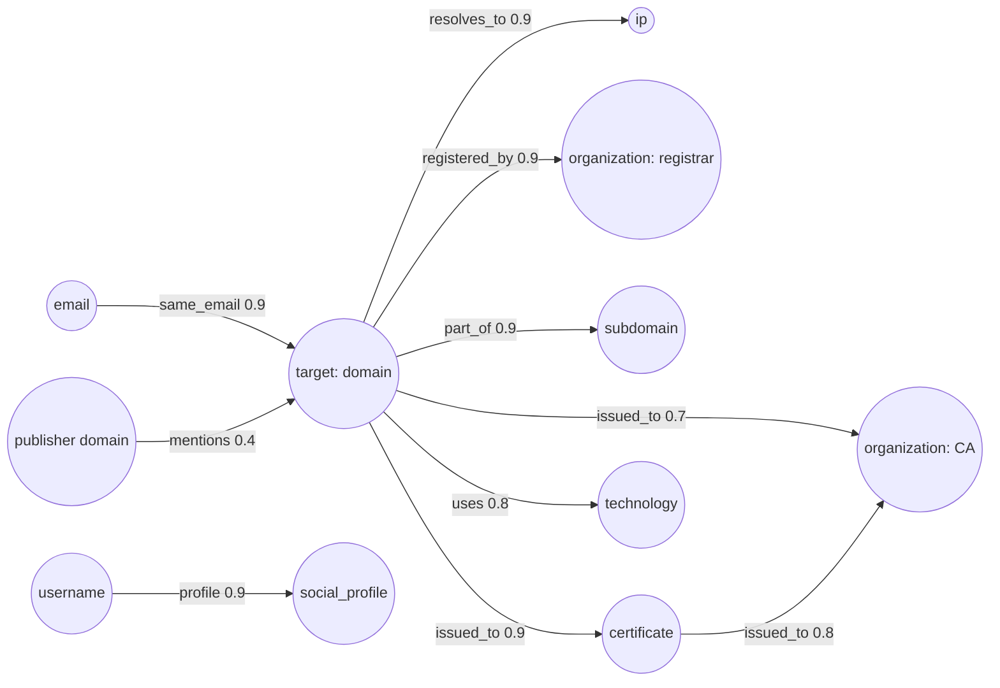

**Table 47.1 – Correlation Edge Types**

| Constant | Edge type | Typical confidence | Example |
|----------|-----------|--------------------|---------|
| `EDGE_RESOLVES_TO` | resolves_to | 0.4–0.9 | domain → IP (A/AAAA), domain → CNAME alias |
| `EDGE_REGISTERED_BY` | registered_by | 0.9 | domain → registrar organisation |
| `EDGE_ISSUED_TO` | issued_to | 0.7–0.9 | domain → issuer / certificate → issuer |
| `EDGE_SAME_EMAIL` | same_email | 0.7–0.9 | email → domain, email → username |
| `EDGE_PART_OF` | part_of | 0.9 | base domain → subdomain |
| `EDGE_MENTIONS` | mentions | 0.4 | publisher domain → target |
| `EDGE_PROFILE` | profile | 0.9 | username → social profile |
| `EDGE_USES` | uses | 0.8 | domain → technology |

**Figure 47.2 – Correlation Edge Types**

```mermaid
flowchart TD
    E1[resolves_to] --> M{DNS applicator}
    E2[registered_by] --> W{WHOIS applicator}
    E3[issued_to] --> S{SSL/certificate applicator}
    E4[same_email] --> EM{Email linkage}
    E5[part_of] --> SD{Subdomain applicator}
    E6[mentions] --> N{News applicator}
    E7[profile] --> U{Username applicator}
    E8[uses] --> T{Tech applicator}
```

When the same edge is added twice, the engine keeps the **maximum** confidence. The graph is fully deterministic — nodes and edges are sorted by stable keys — so exports, persistence, and diffs are byte-stable. If a scan produces no entities, `build_graph` returns `None` rather than an empty graph.

---

# 48. Entity Model

Entities are the lowest common denominator across modules: an IP surfaced by both a DNS A record and a certificate entry is one node. Each module declares extractors against `Finding.data`; the `EntityBag` aggregates occurrences into a single entity with a count and a set of contributing sources.

**Table 48.1 – Entity Kinds**

| Kind | Normalisation |
|------|---------------|
| `domain` | lowercase, strip trailing dot / `*.` |
| `subdomain` | lowercase, strip leading `*.` |
| `email` | lowercase |
| `username` | strip leading `@`, lowercase |
| `ip` | canonical `ipaddress` form |
| `organization` | whitespace-collapsed |
| `certificate` | whitespace-collapsed, uppercase (serial/identity) |
| `document` | lowercase filename |
| `social_profile` | URL verbatim |
| `technology` | lowercase |

Entity ids are `kind:<first-12-hex-of-sha256(normalised value)>`, giving stable, compact identifiers suitable for graph keys and JSON export. `emit()` validates candidates (for example, rejecting domains without a dot, or emails without `@`) so junk never enters the graph.

---

# 49. Risk Engine

The risk engine (`core/risk.py`) is a **pure function**: identical findings always yield identical output. It walks every finding, applies the rule table, de-duplicates identical (rule, finding) pairs, sorts by contribution, and computes per-category sub-scores and a capped total.

```python
score = min(100.0, sum(min(category_score, ceiling[category]) for category in categories))
```

Each matched rule is recorded with its `rule_id`, `category`, `label`, `points`, and the finding it fired on, so the score is fully traceable. A human-readable `summary` lists the overall rating and the top contributing rules.

---

# 50. Risk Rules Catalog

**Table 50.1 – Risk Rule Catalog**

| Rule id | Category | Weight | Module | Trigger |
|---------|----------|--------|--------|---------|
| `tls_cert_expired` | TLS | 35 | ssl | Certificate expired |
| `tls_self_signed` | TLS | 18 | ssl | Self-signed certificate |
| `tls_no_https` | TLS | 10 | http | HTTPS unreachable |
| `headers_trace` | HEADERS | 15 | http_methods | TRACE enabled |
| `headers_hsts` | HEADERS | 9 | headers | HSTS missing |
| `headers_csp` | HEADERS | 9 | headers | CSP missing |
| `headers_cookie_no_secure` | HEADERS | 7 | headers | Cookie without Secure |
| `headers_xframe` | HEADERS | 4 | headers | X-Frame-Options missing |
| `headers_server` | HEADERS | 4 | headers | Server disclosed |
| `headers_xcto` | HEADERS | 3 | headers | X-Content-Type-Options missing |
| `headers_referrer` | HEADERS | 2 | headers | Referrer-Policy missing |
| `headers_cookie_weak` | HEADERS | 2 | headers | Cookie missing HttpOnly/SameSite |
| `headers_permissions` | HEADERS | 2 | headers | Permissions-Policy missing |
| `dns_no_dmarc` | DNS | 6 | dns | No DMARC record |
| `dns_no_spf` | DNS | 4 | dns | No SPF record |
| `dns_dnssec_absent` | DNS | 3 | whois | DNSSEC not signed |
| `dns_no_mx` | DNS | 5 | email | No MX records |
| `dns_spf_allow_all` | DNS | 6 | email | SPF `+all` |
| `dns_dmarc_none` | DNS | 6 | email | DMARC `p=none` |
| `exposure_breach` | EXPOSURE | 20 | breach | Address in breach |
| `exposure_gps` | EXPOSURE | 10 | metadata | GPS in document metadata |
| `exposure_disposable` | EXPOSURE | 4 | email | Disposable provider |

**Table 50.2 – Risk Category Ceilings**

| Category | Rules | Ceiling |
|----------|-------|---------|
| TLS | 3 | 40 |
| HEADERS | 10 | 30 |
| DNS | 6 | 20 |
| EXPOSURE | 3 | 25 |

A few rules are gated by predicates on the finding's data (for example, `dns_spf_allow_all` only fires when the SPF policy is exactly `+all`, and the two cookie rules are mutually exclusive based on whether the `Secure` flag is present). This makes the catalog precise rather than string-matching the web.

---

# 51. Risk Rating and Verdicts

**Table 51.1 – Risk Rating Bands**

| Rating | Score threshold | Verdict |
|--------|-----------------|---------|
| Critical | ≥ 75 | Immediate remediation required |
| High | ≥ 50 | Significant weaknesses found |
| Medium | ≥ 25 | Moderate weaknesses found |
| Low | ≥ 0 | Low overall exposure |

The bands are evaluated highest-first, so the first matching threshold wins. A scan with no contributing findings returns a score of 0 and a LOW rating with an explicit summary line.

---

# 52. Reporting Subsystem

All exporters consume a single shared model, `ReportModel`, built by `reports/builder.py`. The builder re-derives the correlation graph and risk score from the findings when they are not supplied, so reports render correctly even for scans persisted before those phases existed. `ReportModel` contains: `generated_at`, `app`, `scan`, `target`, `findings`, `correlation`, `risk`, `severity_counts`, `module_counts`, `timeline`, `executive_summary`, `evidence_refs`, and `methodology`.

Because every format renders from the same model, JSON, CSV, Markdown, HTML, and PDF outputs remain mutually consistent. The executive summary selects the top three findings by severity; the evidence references cap at six module/title/evidence triples; and the timeline interleaves scan start/finish events with news article publication dates.

---

# 53. Report Templates and Exporters

Five exporters share the `ExportResult(format, data, warning)` contract. Formats are selected case-insensitively; `md`/`markdown`/`mdown` are aliases.

**Table 53.1 – Report Formats**

| Format | Producer | Structure | Caveats |
|--------|----------|-----------|---------|
| JSON | `json.dumps` | Full canonical model, 2-space indent, `default=str` | Machine-consumable; no lossy projection |
| CSV | `csv.writer` | Row per finding: severity, module, title, confidence, evidence | Evidence is truncated for tabular readability |
| Markdown | string builder | Headings, tables, timeline, methodology | Escapes `|` and newlines in cells |
| HTML | Jinja2 (`report.html.j2`) | Branded, self-contained, auto-escaped | Print mode adds page-break styling |
| PDF | WeasyPrint | Rendered from the HTML template | Falls back to print HTML if WeasyPrint/system libs absent |

**Figure 53.1 – Export Pipeline**

```mermaid
flowchart LR
    M[ReportModel] --> J[JSON exporter]
    M --> C[CSV exporter]
    M --> MD[Markdown exporter]
    M --> H[HTML exporter]
    H --> P[WeasyPrint]
    P -->|available| PDF[PDF bytes]
    P -->|missing libs| FB[print HTML + warning]
    BRAND[brand_tokens] -.-> H
    TPL[report.html.j2] -.-> H
```

The HTML template consumes `brand_tokens()` derived from `BRAND.md`, keeping colours/identity centralised. HTML auto-escaping is enabled for `html`, `j2`, and `xml` so hostile finding content cannot inject script (threat T2). PDF export imports WeasyPrint lazily via `importlib`; if either the package or its system libraries (Pango, Cairo) are missing, it transparently writes a print-friendly HTML and returns an explicit warning rather than failing — a deliberate graceful degradation documented for the user.

---

# 54. Command-Line Interface

The CLI is built on Typer with Rich rendering. The root command is `intelxtract`; six sub-applications group related commands. It provides full functional parity with the GUI for headless and automation use.

**Table 54.1 – CLI Command Reference**

| Command | Purpose | Key options |
|---------|---------|-------------|
| `scan <target>` | Run a scan and persist it | `--mode/-m`, `--modules/-M`, `--format/-f console|json`, `--db` |
| `report <scan_id>` | Render a saved scan | `--format json|html|pdf|csv|md`, `--out`, `--db` |
| `explain <scan_id>` | AI/rule-based narrative | `--kind summary|next-steps|finding|compare`, `--finding`, `--compare`, `--json` |
| `history list` | List scans | `--target/-t`, `--status/-s`, `--db` |
| `history show <scan_id>` | Scan detail | `--db` |
| `config get/set/list/path` | Inspect/modify config | dotted keys (`config get cache.ttl`) |
| `key list/set/get/delete` | Manage encrypted keys | `--value`, `--reveal`, `--yes/-y` |
| `plugin list/info/enable/disable` | Manage plugins | `--db` |
| `schedule add/list/remove/enable/disable/run` | Recurring scans | `--every`, `--cron`, `--mode`, `--disabled`, `--once`, `--iterations`, `--poll` |
| `case create/list/show/note/attach/export` | Investigations | `--description`, `--status`, `--db` |
| `doctor` | Environment health check | — |
| `update` | Check PyPI for a newer version | — |
| `--version` | Print version | — |

The root callback configures logging (with `-v` switching to DEBUG) and supports `--version`. `doctor` runs a sequence of environment checks (Python version, virtual-environment presence, config readability, dependency availability) and prints a pass/fail report. `update` compares the running version against the latest on PyPI without sending identifying information.

---

# 55. GUI Architecture

The desktop client is built with PySide6 (Qt 6) and drives the **same engine** as the CLI on a background thread, keeping the interface responsive during scans.

**Figure 55.1 – GUI Architecture**

```mermaid
flowchart TB
    subgraph UI["Main Window (Qt main thread)"]
        NAV[Navigation / Sidebar]
        PAGES[13 Pages]
        VIZ[Visualisations]
    end
    subgraph Bridge["EngineBridge (QThread)"]
        SIG[Qt signals: started / progress / finished / moduleDone / log]
    end
    ENGINE[ScanEngine + WorkerPool]
    DB[(SQLite)]
    CTX[AppContext]
    UI <-->|slots & signals| Bridge
    Bridge --> ENGINE
    ENGINE --> DB
    CTX -.-> UI
    CTX -.-> ENGINE
    DB_SYNC[db_sync] --> UI
    CASE_SYNC[case_sync] --> UI
```

`EngineBridge` owns a `QThread` that runs the asyncio event loop; the engine's synchronous callbacks (`on_module_done`, progress) are marshalled to the UI thread via Qt signals, so no widget is ever touched from a worker thread. `gui/context.py` (`AppContext`) wires configuration, database, and registries; `gui/db_sync.py` and `gui/case_sync.py` keep list views in sync with persistence; `gui/theme.py` defines the visual theme.

---

# 56. GUI Pages

**Table 56.1 – GUI Pages**

| Page | Function |
|------|----------|
| Dashboard | Overview: recent scans, risk summary, quick actions |
| Quick Scan | One-click profile scan (quick mode) |
| Deep Scan | Full-profile scan with module selection |
| Results | Findings table with severity filters and detail pane |
| History | Browse and reopen past scans |
| Reports | Generate and export reports in any format |
| Cases | Create investigations, add notes, attach evidence, export combined case report |
| Schedules | Manage recurring scans; run scheduler |
| Plugins | Enable/disable plugins, view manifest metadata |
| API Manager | Manage encrypted API keys |
| Assistant | Opt-in AI narrative/explanations |
| Settings | Edit configuration values |
| About | Version, licence, and project links |

`scan_page.py` and `base.py` provide shared scan-page scaffolding consumed by the quick and deep scan pages.

**Figure 56.1 – GUI Navigation Flow**

```mermaid
flowchart LR
    D[Dashboard] --> Q[Quick Scan]
    D --> R[Results]
    Q --> R
    R --> REP[Reports]
    D --> H[History]
    D --> C[Cases]
    D --> S[Schedules]
    SET[Settings] --> API[API Manager]
    D --> A[Assistant]
    D --> P[Plugins]
```

The following figures are screenshot placeholders to be populated from a running instance before submission:

- **Figure 56.2 – Dashboard Page** *(screenshot placeholder)*
- **Figure 56.3 – Quick Scan Page** *(screenshot placeholder)*
- **Figure 56.4 – Results Page** *(screenshot placeholder)*
- **Figure 56.5 – Correlation Graph Visualisation** *(screenshot placeholder)*
- **Figure 56.6 – Cases Page** *(screenshot placeholder)*
- **Figure 56.7 – Reports Page** *(screenshot placeholder)*
- **Figure 56.8 – API Manager Page** *(screenshot placeholder)*
- **Figure 56.9 – Scheduler Page** *(screenshot placeholder)*

---

# 57. GUI Visualizations

**Table 57.1 – Visualisation Widgets**

| Widget | Module | Description |
|--------|--------|-------------|
| Severity/Module charts | `viz/charts.py` | Bar/donut summaries of findings by severity and module |
| Correlation graph | `viz/graph_widget.py` | Interactive NetworkX entity graph rendering |
| Timeline | `viz/timeline.py` | Chronological scan/news events |
| World map | `viz/world_map.py` | Geographic plotting of IP geolocation findings |

**Figure 57.1 – Visualization Data Flow**

```mermaid
flowchart LR
    SCAN[ScanResult] --> CH[charts: severity/module counts]
    SCAN --> GR[graph_widget: entities + edges]
    SCAN --> TL[timeline: scan + news events]
    GEO[geo findings] --> WM[world_map: coordinates]
```

Charts are rendered without external plotting dependencies by painting directly with Qt, keeping the dependency footprint small. The graph widget lays out the correlation MultiDiGraph, the timeline orders events by timestamp, and the world map plots geolocation points on a bundled equirectangular base map.

---

# 58. AI Assistant

The AI assistant is **disabled by default** and strictly opt-in. It has two layers: a deterministic, offline analysis path that always works, and an optional OpenAI-compatible chat path that activates only when a user configures an endpoint.

**Table 58.1 – Assistant Modes**

| Mode | Provider | Network | Description |
|------|----------|---------|-------------|
| Off (default) | `DisabledAssistant` | None | Returns `DISABLED_WARNING`; no data leaves the host |
| Deterministic | rule-based `Assistant` | None | Summary, next-steps, finding, and comparison narratives |
| Remote | `OpenAICompatibleAssistant` | HTTPS to user endpoint | Sends the report payload to `/chat/completions` |

The assistant exposes `AssistantAnswer` objects labelled `AI-generated`, and `build_default_provider()` selects the provider from configuration. The provider protocol (`AssistantProvider`) returns `AssistantResponse`/`ChatMessage` values. Because the remote path is opt-in, the threat model (T10) treats it as an explicit, disclosed egress. The CLI `explain` command and the Assistant GUI page share this service; when disabled, `explain` still produces the deterministic answer.

---

# 59. Plugin SDK

Plugins extend IntelXtract with new collectors without touching the core. A plugin lives in its own directory and declares a manifest plus a module class.

**Table 59.1 – Plugin Package Layout**

| File | Purpose |
|------|---------|
| `manifest.json` | Name, version, `api_version`, entry, description |
| `plugin.py` | `PluginBase` subclass returning `BaseModule` instances |

`PluginBase` subclasses declare their modules; `PluginModuleAdapter` wraps each contributed module so the registry treats it identically to a built-in collector. The loader validates the manifest against `MANIFEST_SCHEMA`, enforces `PLUGIN_API_VERSION`, imports the module in isolation, and records failures in the `plugins` table (with an `error` column) without crashing the application. Plugins are explicitly **trusted code** run with the application's privileges — a residual risk accepted and disclosed.

Two example plugins ship in the repository: **Wayback** (historical snapshots from the Internet Archive) and **VirusTotal** (key-gated reputation). A `_template` plugin demonstrates the minimal structure.

**Figure 59.1 – Plugin Lifecycle**

```mermaid
flowchart LR
    DIR[Plugin directory] --> MAN[Read manifest.json]
    MAN --> VAL{Schema + api_version valid?}
    VAL -->|no| DIS[Disabled + error recorded]
    VAL -->|yes| IMP[Import plugin.py]
    IMP --> ADP[PluginModuleAdapter]
    ADP --> REG[ModuleRegistry]
    REG --> SCAN[Available to scans]
```

---

# 60. API Key Vault and Secrets Management

API keys are encrypted at rest with **Fernet** (symmetric authenticated encryption from `cryptography`). The vault key itself is resolved from, in order: the `INTELXTRACT_VAULT_KEY` environment variable, the OS keychain via `keyring`, or a `0600` key file.

**Figure 60.1 – Vault Key Resolution and Key Precedence**

```mermaid
flowchart TB
    subgraph KeyOfKeys["Vault key resolution"]
        ENV[INTELXTRACT_VAULT_KEY] --> KR[OS keyring]
        KR --> KF[0600 key file]
    end
    subgraph Precedence["Runtime API key precedence"]
        E[env / .env] --> V[vault]
        V --> C[config]
    end
```

`vault.py` exposes `mask()` (for safe display) and `hydrate_api_keys()` (to inject resolved keys into module contexts at scan time). The runtime precedence is **env/`.env` > vault > config**, so an operator can override a stored key per environment without decrypting the vault. Keys are redacted from logs by the logger's redaction rules and are excluded from reports by construction. `key get` masks by default; `--reveal` prints the plaintext only on explicit request.

---

# 61. Case Management

A *case* groups scans and findings into a single investigation (migration 4: `cases`, `case_notes`, `case_evidence`). Cases support a name, description, and status (open/closed), free-text notes, and evidence links to either a whole scan or a specific finding.

**Figure 61.1 – Case Entity Relationships**

```mermaid
flowchart LR
    CASE((case)) --> NOTE[case_note]
    CASE --> EV[case_evidence]
    EV -->|kind=scan| SCAN[scan]
    EV -->|finding link| FIN[finding]
    SCAN --> FIN2[findings]
```

Combined case export aggregates the findings of every attached scan, de-duplicating by finding id (`collect_case_payload`), and renders one report across the investigation — including notes and evidence labels. This turns a series of point-in-time scans into a coherent, exportable dossier. The CLI provides `case create/list/show/note/attach/export`, mirrored by the Cases GUI page.

---

# 62. Scheduler and Change Detection

The scheduler supports both fixed **intervals** (`--every` seconds) and **cron** expressions (`--cron "minute hour day month weekday"`). A pure `CronExpression` parser and `compute_next_run()` function compute the next fire time deterministically; bounds and field names are validated up front.

**Figure 62.1 – Scheduler Loop**

```mermaid
flowchart TB
    TICK[Scheduler tick] --> DUE{Due schedules}
    DUE -->|none| SLEEP[Sleep poll interval]
    DUE -->|one+| RUN[Run scan]
    RUN --> DIFF[Diff vs previous scan]
    DIFF --> DELTA[FindingDelta: added / removed / changed]
    DELTA --> HIST[Persist history events]
    RUN --> NEXT[Compute next_run_at]
    NEXT --> SLEEP
```

Change detection (`diff_findings`) compares a scan's findings against the previous scan for the same target and produces a `FindingDelta` of added, removed, and changed findings (matched by `content_hash`). This is persisted to the `history` table, giving an audit trail of how a target's posture changed over time. Overlap protection prevents a slow run from being re-triggered before it finishes, and `ScheduleRunner`/`ScheduleStore` keep the loop decoupled from the database.

---

# 63. Threat Model

The threat model (documented in `docs/threat_model.md`) treats everything beyond the application boundary as untrusted, **including responses from the targets the user chooses to scan**.

**Table 63.1 – Threat Summary**

| # | Threat | Mitigation |
|---|--------|------------|
| T1 | Hostile target payload (huge HTML, decompression bomb, malformed cert/EXIF/XML) | Size caps, timeouts, safe parsers, offloaded parsing, no `eval`/`pickle` |
| T2 | XSS / script injection into reports | Jinja2 auto-escape, escaped raw values, CSP meta tag |
| T3 | Secret leakage | Logger redaction, vault as sole key source, reports exclude secrets |
| T4 | Local theft of DB/keys | `0600`/`0700` permissions, Fernet encryption, keyring when available |
| T5 | Supply-chain compromise | Minimal pinned dependencies, stdlib-first, version-checked plugin imports |
| T6 | Runaway resource use | Pool limits, per-host semaphores, bounded retries, scheduler overlap prevention |
| T7 | SSRF via redirects to internal hosts | Block loopback/link-local/metadata ranges by default; explicit opt-in |
| T8 | Rate-limit / ToS violations | Global + per-host limits, robots.txt respect, polite key-gating |
| T9 | Plugin escape | Manifest gating, isolated import failure, explicit enablement; plugins trusted |
| T10 | AI prompt exfiltration | AI disabled by default; opt-in with disclosure of receiving endpoint |
| T11 | Audit gap | Local scan history and logged settings/key changes |

**Figure 63.1 – Trust Boundaries**

```mermaid
flowchart LR
    USER[User] --> APP[IntelXtract app]
    APP --> FS[(Local FS: DB, config, logs, exports)]
    APP --> TARGETS[Scan targets: DNS/WHOIS/HTTP/TLS/CT]
    APP --> APIS[Optional APIs: VT, HIBP, AbuseIPDB]
    APP --> AI[Optional AI endpoint]
    classDef untrusted fill:#fdd;
    class TARGETS,APIS,AI untrusted;
```

The design enforces an **ethical and legal boundary**: only publicly available information and authorised APIs; no exploitation, credential attacks, or authentication-bypass code; robots.txt is respected on profile checks; and out-of-scope items (multi-user hardening, traffic anonymisation, anti-forensics) are explicitly listed.

---

# 64. Privacy and Ethical Considerations

IntelXtract is **local-first**. The privacy statement (`docs/privacy.md`) commits to four principles: local-first storage, no telemetry, no account, and opt-in egress only.

**Table 64.1 – Data Egress**

| Egress | Trigger | Data sent |
|--------|---------|-----------|
| Scan targets | Every scan | Normal protocol traffic only |
| Public APIs (CT, geo, RSS, site checks) | Enabled modules | The researched indicator, nothing about the user |
| Key-gated providers | Key added **and** module enabled | Indicator + that provider's API key |
| AI endpoint | Explicit opt-in | The report payload, to the user's endpoint |
| PyPI | `intelxtract update` only | Version metadata |

**Table 64.2 – Data Stored Locally**

| Data | Location |
|------|----------|
| Targets & scan history | Local SQLite DB |
| Findings, correlation, risk | Local SQLite DB |
| Reports | `exports/` |
| Settings (no secrets) | `config/settings.json` |
| Encrypted keys | DB `api_keys` / OS keychain |
| Logs (redacted) | `logs/` |
| Cache | `cache/` |

The ethical stance acknowledges that scanned data may contain personal data about third parties (public WHOIS contacts, profiles), making the operator responsible for lawful handling. Full removal is achieved by deleting the data directory (`config path`), `config/`, `logs/`, and `cache/`. No identifying telemetry is ever emitted, and all egress can be routed through a user-configured proxy.

---

# 65. Testing Strategy

Testing follows the project's quality gate: **lint, format, type-check, and test must all pass** before any change is committed.

```console
export PATH="$PWD/.venv/bin:$PATH" && black . && ruff check . && mypy . && pytest -p no:cacheprovider -rN
```

**Figure 65.1 – Test Pyramid and Gate**

```mermaid
flowchart TB
    subgraph Gate
        B[black] --> R[ruff]
        R --> M[mypy]
        M --> P[pytest]
    end
    subgraph Pyramid
        E2E[Integration / E2E]
        QT[pytest-qt GUI tests]
        UNIT[Unit tests]
        E2E --> QT --> UNIT
    end
```

The strategy is layered: **unit tests** for pure logic (risk rules, correlation, cron, config precedence, cache), **module tests** with mocked HTTP for every collector, **database tests** covering migrations and repositories, **CLI tests** via Typer's runner, **GUI tests** using `pytest-qt`, and **integration tests** (including an offline end-to-end scan) marked so CI can exclude or include them deliberately. Coverage is enforced with `fail_under=80`, branch coverage, restricted to `core`, `modules`, `reports`, and `plugins`.

---

# 66. Test Suites and Coverage

**Table 66.1 – Test Suite Summary**

| Suite | Representative files | Focus |
|-------|---------------------|-------|
| Core | `tests/core/test_engine.py`, `test_cache.py`, `test_config.py`, `test_correlation.py`, `test_risk.py`, `test_scheduler.py`, `test_scheduling.py`, `test_vault.py`, `test_offload.py`, `test_worker_pool.py` | Engine, config, correlation, risk, scheduling, vault, concurrency |
| Modules | `tests/modules/**` (per collector), `test_http_client.py` | Finding correctness, HTTP behaviours, caching, concurrency caps |
| Database | `tests/database/test_migrations.py`, repository tests | Forward migrations and typed repositories |
| CLI | `tests/cli/test_cli.py` | Command wiring, output, exit codes |
| GUI | `tests/gui/test_qtbot.py`, `test_smoke.py`, `test_viz.py` | Widget construction and interactions |
| Integration | `tests/integration/test_offline_scan.py` | End-to-end offline scan |
| Assistant / Reports / Plugins | `tests/assistant/**`, `tests/reports/**`, `tests/plugins/**` | Provider selection, golden report, plugin loading |
| Performance | `tests/core/test_performance_budget.py`, `tests/test_bench.py` | Performance budget + benchmark smoke |

**Table 66.2 – Measured Results**

| Metric | Value |
|--------|-------|
| Test files | 81 |
| Tests passing | 756 |
| Branch coverage | 89.54% |
| Coverage gate | `fail_under = 80` |

The suite includes golden-file tests for reports (`tests/reports/golden/report.json`) to detect unintended output drift, and a performance-budget test that fails if core operations regress beyond their budget.

---

# 67. Performance and Benchmarks

Performance work (Phase 25) targeted four axes: connection pooling, cache integration, retry logic, and offloading, under a strict "no unboundedness" policy.

**Table 67.1 – Benchmark Baseline** (2026-10-11, Linux, Python 3.14)

| Section | Metric | Value |
|---------|--------|-------|
| Cache | Ops/second | 2,550,909 |
| Cache | Hit rate | 1.00 |
| Engine | Scans/second | 7,414 (8 modules/scan) |
| Offload | Ops/second | 15,344 (4 workers) |

The `HttpClient` owns one keep-alive `aiohttp.TCPConnector` per client with total and per-host connection caps and a DNS cache. The shared `AsyncTTLCache` caches module results and HTTP responses carrying `ETag`/`Last-Modified`, revalidating with `If-None-Match`/`If-Modified-Since` and serving cached bodies on `304`. Retries use exponential backoff with equal jitter, only for idempotent methods (GET/HEAD/OPTIONS/PUT/DELETE) on 408/429/5xx. Blocking PDF/EXIF/OOXML parsing and the username registry load run on a bounded offload pool.

**Table 67.2 – Concurrency Configuration**

| Key | Default | Meaning |
|-----|---------|---------|
| `network.pool_limit` | 100 | Max open connections |
| `network.pool_limit_per_host` | 8 | Max connections to one host |
| `network.max_concurrency` | 16 | Global in-flight cap (0 = off) |
| `network.max_per_host` | 4 | Per-host in-flight cap (0 = off) |
| `network.rate_limit` | 0 | Global requests/sec (0 = off) |
| `network.rate_limit_per_host` | 0 | Per-provider requests/sec (0 = off) |
| `network.backoff_base` / `backoff_max` | 0.5 / 30 | Retry delay growth and cap (s) |
| `network.http_cache` | true | ETag/conditional response caching |
| `performance.offload_workers` | 4 | Bounded per-scan offload pool |
| `cache.ttl` / `cache.max_size` | 300 / 1024 | Cache expiry and size |

**Figure 67.1 – Request Admission Control**

```mermaid
flowchart LR
    REQ[Request] --> G{global semaphore}
    G --> H{per-host semaphore}
    H --> P{rate limiters}
    P --> SESSION[aiohttp session]
    SESSION -->|408/429/5xx| RETRY[Backoff retry]
    SESSION -->|ETag 304| CACHE[Serve cached body]
```

Ordering is deadlock-free: every request acquires the global slot before the per-host slot before the session call. Semaphores are per-`HttpClient` (per scan), so parallel scans never share or exhaust one another's budgets. Absolute numbers vary by machine and are intended as same-host comparability indicators.

---

# 68. Packaging and Distribution

IntelXtract is distributed as a Python wheel/sdist, as standalone PyInstaller binaries, and as a Docker image.

**Table 68.1 – Distribution Artefacts**

| Artefact | Builder | Target |
|----------|---------|--------|
| Wheel (`.whl`) + sdist (`.tar.gz`) | `python -m build` | `pip install intelxtract` |
| CLI binary (`intelxtract`) | PyInstaller `intelxtract-cli.spec` | Linux x86_64, no Python needed |
| GUI binary (`intelxtract-gui`) | PyInstaller `intelxtract-gui.spec` | Linux x86_64 |
| Docker image | `Dockerfile` / `docker-compose.yml` | Reproducible headless runtime |
| Checksums | `sha256sum`/`sha512sum` | Integrity verification |

Build scripts (`scripts/build.sh`, `scripts/build.ps1`) automate the local workflow. The package exposes two console entry points: `intelxtract = "cli.main:app"` and `intelxtract-gui = "gui:main"`. Metadata declares GPL-3.0-or-later licensing, `requires-python >= 3.13`, and a minimal, pinned runtime dependency set (aiohttp, aiosqlite, typer, rich, jinja2, PySide6, cryptography, networkx, Pillow, pypdf), with optional `dev`, `build`, and PDF/keyring extras.

**Figure 68.1 – Packaging Pipeline**

```mermaid
flowchart LR
    SRC[Source tree] --> WHEEL[wheel + sdist]
    SRC --> PYI[PyInstaller specs]
    PYI --> CLI[intelxtract binary]
    PYI --> GUI[intelxtract-gui binary]
    SRC --> DOCKER[Docker image]
    WHEEL --> REL[GitHub Release]
    CLI --> REL
    GUI --> REL
    REL --> SUM[sha256/sha512 checksums]
```

The `# [tool.pyinstaller]` section records the two spec files. System dependencies are explicit: PDF export needs WeasyPrint plus Pango/Cairo/GDK-Pixbuf/fontconfig; the GUI needs Qt6 runtime libraries. Docker runs Linux-native and is usable on macOS/Windows via Docker Desktop.

---

# 69. CI/CD Pipeline

Continuous integration and release are driven by two GitHub Actions workflows.

**Table 69.1 – CI Workflow**

| Aspect | Configuration |
|--------|---------------|
| Trigger | push/PR to `main` |
| Runner | `ubuntu-latest` |
| Matrix | Python 3.13 and 3.14 |
| Steps | checkout → `uv` setup → venv + deps → Qt libs → ruff → black `--check` → mypy → pytest (`-m "not integration"`) with coverage |

**Table 69.2 – Release Workflow**

| Aspect | Configuration |
|--------|---------------|
| Trigger | tag `v*` |
| Permissions | `contents: write`, `packages: write` |
| Timeout | 30 minutes |
| Steps | quality gate → wheel/sdist → PyInstaller CLI binary → GUI binary → binary smoke tests → checksums → draft GitHub Release |

**Figure 69.1 – CI/CD Flow**

```mermaid
flowchart LR
    PUSH[push / PR] --> CI[CI quality job]
    CI -->|ruff| R1[ruff]
    CI -->|format| R2[black --check]
    CI -->|types| R3[mypy]
    CI -->|tests| R4[pytest + coverage]
    TAG[tag v*] --> REL[Release job]
    REL --> QG[quality gate]
    QG --> B1[wheel + sdist]
    REL --> B2[PyInstaller CLI]
    REL --> B3[PyInstaller GUI]
    B2 --> SMOKE[binary smoke tests]
    B1 --> GH[draft GitHub Release]
    B3 --> GH
    SMOKE --> GH
    GH --> CS[checksums]
```

The CI job installs the exact Qt system libraries needed for offscreen GUI tests. The release job additionally installs WeasyPrint's system libraries so PDF generation is exercised, builds both binaries, then **smoke-tests the CLI binary** (`--version`, `doctor`, and a real `scan example.com --mode quick --format json`) before publishing a draft release with generated notes and checksums. Versions are pinned with `==` throughout, satisfying the supply-chain goal (T5).

---

# 70. Comparison with Existing Tools

IntelXtract is positioned between single-purpose reconnaissance tools (which do one thing well) and heavyweight commercial platforms (which require accounts and cloud processing).

**Table 70.1 – Feature Comparison**

| Capability | IntelXtract | Typical `whois`/`dig` | `theHarvester` | Maltego | Shodan |
|------------|-------------|----------------------|----------------|---------|--------|
| Dual CLI + desktop GUI | Yes | No | No | Desktop GUI | Web |
| Local-first / no account | Yes | Yes | Yes | Partial | No |
| Correlation graph | Yes (NetworkX) | No | No | Yes | No |
| Deterministic risk score | Yes (22 rules) | No | No | Partial | No |
| Multi-format reports | JSON/CSV/MD/HTML/PDF | No | Text/HTML | Yes | Yes |
| Email/breach checks | Yes (key-gated) | No | Partial | Via transforms | No |
| Plugin SDK | Yes | No | No | Yes (transforms) | No |
| Encrypted key vault | Yes (Fernet) | N/A | No | Yes | N/A |
| Case management | Yes | No | No | Yes | No |
| Recurring scans + diff | Yes | No | No | Partial | Partial |
| AI narrative (opt-in) | Yes | No | No | No | No |
| Open source | Yes (GPL-3.0+) | Yes | Yes | No | No |

**Figure 70.1 – Positioning**

```mermaid
quadrantChart
    x-axis "Low automation" --> "High automation"
    y-axis "Narrow scope" --> "Broad scope"
    quadrant-1 "Commercial platforms"
    quadrant-2 "IntelXtract"
    quadrant-3 "Single-purpose CLI tools"
    quadrant-4 "Scripted pipelines"
    "dig/whois": [0.15, 0.1]
    "theHarvester": [0.35, 0.3]
    "Maltego": [0.75, 0.85]
    "Shodan": [0.8, 0.5]
    "IntelXtract": [0.72, 0.72]
```

IntelXtract's distinguishing combination is **local-first operation with no account or telemetry**, a **deterministic, auditable risk model**, integrated **correlation and case management**, and a **dual CLI/GUI** — without the cloud dependency and per-seat cost of commercial platforms.

---

# 71. Advantages

- **Local-first and private** — no account, no telemetry, opt-in egress only; all data resides in a user-controlled SQLite database and export directory.
- **Deterministic and auditable** — the risk engine is a pure function; identical findings yield identical scores, and every matched rule is traceable to its finding.
- **Modular and extensible** — 19 built-in collectors behind a uniform `BaseModule` interface plus a manifest-gated Plugin SDK.
- **Full parity interfaces** — CLI and GUI drive the same engine and database, so automation and interactive use are interchangeable.
- **Integrated intelligence pipeline** — collection → entity extraction → correlation → risk scoring → multi-format reporting, plus case management and historical diffing.
- **Resilient networking** — connection pooling, ETag caching, bounded concurrency and per-host pacing, and jittered exponential-backoff retries.
- **Security-conscious by design** — encrypted key vault, log redaction, report auto-escaping, SSRF redirection guards, and a documented threat model.
- **Quality-gated** — 756 passing tests at 89.54% branch coverage under a strict lint/type/test gate, with a reproducible benchmark baseline.
- **Reproducible distribution** — pinned dependencies, wheel/sdist, standalone binaries, Docker image, and checksummed releases via CI/CD.

---

# 72. Limitations and Future Enhancements

**Table 72.1 – Known Limitations and Planned Enhancements**

| Area | Current limitation | Planned enhancement |
|------|--------------------|---------------------|
| Hash targets | No collector for file-hash (HASH) targets | Hash reputation module (key-gated) |
| IP scope | DNSBL limited to Spamhaus; IPv6 out of scope for DNSBL | Additional DNSBLs / IPv6 support |
| Port scanning | Active service/port identification intentionally omitted | Only if kept passive/authorised |
| Concurrency store | Semaphores are per-process | Distributed rate limiting for multi-worker deployments |
| API surface | No REST API | Optional self-hosted REST API |
| Collaboration | Single-user, local database | Optional self-hosted shared cases |
| AI | Remote provider is generic OpenAI-compatible | Provider-specific adapters and richer prompts |
| PDF | Depends on WeasyPrint system libraries | Bundled renderer / alternate backend |
| Anonymity | No traffic anonymisation | Optional Tor/proxy management |
| Version metadata | `core/config.py` default version string lags `core/constants.VERSION` | Unify version sourcing across modules |

The most significant engineering limitation is the deliberate exclusion of any offensive capability — no exploitation, credential attacks, or authentication bypass — which is an ethical design constraint, not a technical gap. Several inconsistencies noted during authoring remain as documentation follow-ups: the Phase Plan summary still shows some completed phases unchecked, the README badge/status text lags the 1.0.0 release, and the default `app.version` in configuration is stale relative to the canonical constant.

---

# 73. Conclusion

IntelXtract demonstrates that a **local-first, account-free OSINT platform** can deliver the breadth of commercial tooling without its privacy, cost, and cloud dependencies. The system unifies 19 reconnaissance collectors, an asynchronous scan engine with bounded concurrency, an entity-centric correlation graph, a 22-rule deterministic risk model, and multi-format reporting behind both a command-line and a desktop interface.

Every phase was delivered against a uniform quality gate — formatting, linting, static typing, and testing on Python 3.13 and 3.14 — reaching 756 passing tests and 89.54% branch coverage, with a reproducible benchmark baseline and a fully automated release pipeline producing wheel/sdist, standalone binaries, a Docker image, and checksummed GitHub releases. Correctness and safety were treated as first-class: the risk engine is a pure function, the correlation graph is byte-stable, secrets are Fernet-encrypted and redacted from logs, report rendering is auto-escaped, and scanning is constrained to passive, authorised, publicly available sources.

The project therefore meets its objectives of breadth, determinism, extensibility, and privacy, while documenting its limits honestly. Its modular architecture and Plugin SDK leave clear room for the planned enhancements — REST API, additional key-gated providers, and richer collaboration — without compromising the local-first guarantees that define it.

---

# 74. References and Appendices

## 74.1 References

1. Python Software Foundation. *Python 3.13 / 3.14 Documentation.* https://docs.python.org/3/
2. aiohttp contributors. *aiohttp — Asynchronous HTTP Client/Server for asyncio.* https://docs.aiohttp.org/
3. Pallets. *Jinja2 Documentation.* https://jinja.palletsprojects.com/
4. Tiangolo, S. *Typer — CLI library for Python.* https://typer.tiangolo.com/
5. Rich contributors. *Rich — Text formatting for the terminal.* https://rich.readthedocs.io/
6. The Qt Company. *Qt 6 / PySide6 Documentation.* https://doc.qt.io/qtforpython/
7. Cryptography contributors. *cryptography — Fernet (symmetric encryption).* https://cryptography.io/
8. NetworkX developers. *NetworkX Documentation.* https://networkx.org/documentation/
9. aiosqlite contributors. *aiosqlite — asyncio interface to SQLite.* https://aiosqlite.omnilib.dev/
10. SQLite Consortium. *SQLite Documentation.* https://www.sqlite.org/docs.html
11. WeasyPrint contributors. *WeasyPrint — HTML to PDF.* https://weasyprint.org/
12. Haxx. *cURL / libcurl — transport reference (robots.txt, HTTP).* https://curl.se/
13. Balliet, S. *Have I Been Pwned API.* https://haveibeenpwned.com/API/v3
14. AbuseIPDB. *AbuseIPDB API Documentation.* https://docs.abuseipdb.com/
15. The Spamhaus Project. *Spamhaus DNSBL / ZEN.* https://www.spamhaus.org/
16. Internet Archive. *Wayback Machine / CDX API.* https://web.archive.org/
17. crt.sh / Sectigo. *Certificate Transparency log search.* https://crt.sh/
18. Chen, E., et al. *The Architecture of Open Source Applications* (asyncio concurrency patterns).
19. OWASP Foundation. *OWASP Secure Headers Project.* https://owasp.org/www-project-secure-headers/
20. RFC 7480–7484. *Registration Data Access Protocol (RDAP).* IETF.
21. RFC 7208. *Sender Policy Framework (SPF).* IETF.
22. RFC 7489. *Domain-based Message Authentication, Reporting, and Conformance (DMARC).* IETF.
23. RFC 6376. *DomainKeys Identified Mail (DKIM).* IETF.
24. `docs/architecture.md`, `docs/Database_Schema.md`, `docs/threat_model.md`, `docs/privacy.md`, `docs/performance.md` (IntelXtract project documentation).

## 74.2 Appendix A – Configuration Defaults

| Key | Default |
|-----|---------|
| `app.name` / `app.version` | `IntelXtract` / `1.0.0` (`core.constants`) |
| `scan.default_mode` / `default_timeout` | `quick` / `30.0` |
| `scan.max_workers` | `8` |
| `cache.enabled` / `ttl` / `max_size` | `true` / `300.0` / `1024` |
| `logging.level` / `file` | `INFO` / `logs/intelxtract.log` |
| `logging.max_bytes` / `backup_count` | `1048576` / `3` |
| `network.user_agent` | `IntelXtract/...` |
| Env prefix / config path | `INTELXTRACT_` / `.env`, `config/settings.json` |

## 74.3 Appendix B – Correlation Edge Types

| Edge | Meaning |
|------|---------|
| `resolves_to` | domain → IP / alias |
| `registered_by` | domain → registrar organisation |
| `issued_to` | domain / certificate → issuer |
| `same_email` | email → domain / username |
| `part_of` | base domain → subdomain |
| `mentions` | publisher domain → target |
| `profile` | username → social profile |
| `uses` | domain → technology |

## 74.4 Appendix C – Screenshot Placeholders

The following figures should be populated with screenshots before submission:

| Figure | Screenshot |
|--------|-----------|
| Figure 56.2 | Dashboard page with a completed scan |
| Figure 56.3 | Quick Scan page configuration |
| Figure 56.4 | Results page with severity filters |
| Figure 56.5 | Correlation graph visualisation |
| Figure 56.6 | Cases page with notes and evidence |
| Figure 56.7 | Reports page with format selection |
| Figure 56.8 | API Manager page (masked keys) |
| Figure 56.9 | Scheduler page |

## 74.5 Appendix D – Reproduction Commands

```console
# Quality gate
export PATH="$PWD/.venv/bin:$PATH" && black . && ruff check . && mypy . && pytest -p no:cacheprovider -rN

# Benchmark
python scripts/bench.py --json

# Run a scan and export every format
intelxtract scan example.com --mode deep
intelxtract scan example.com --mode deep --format json
intelxtract report 1 --format html --out exports/report.html
```

*End of report.*